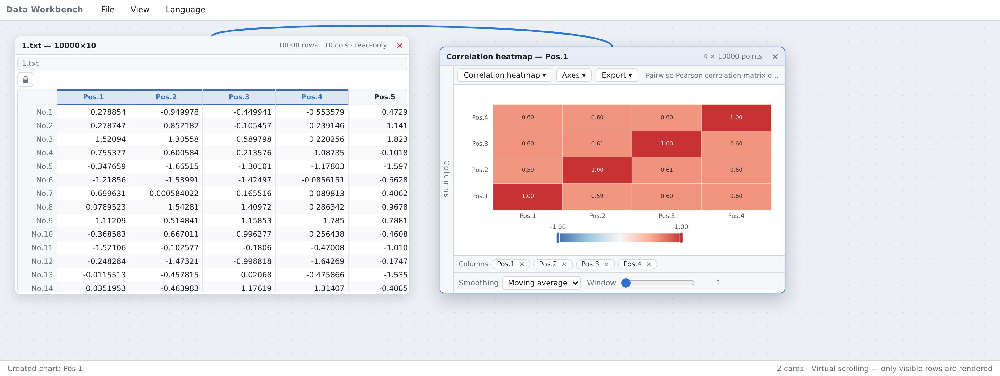
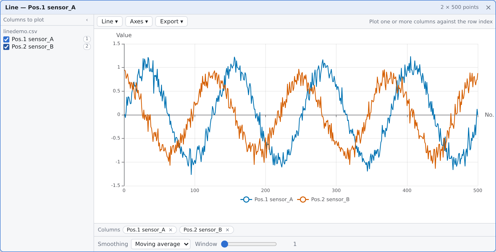
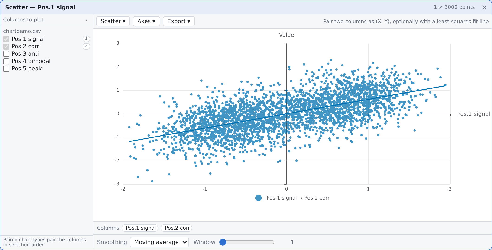
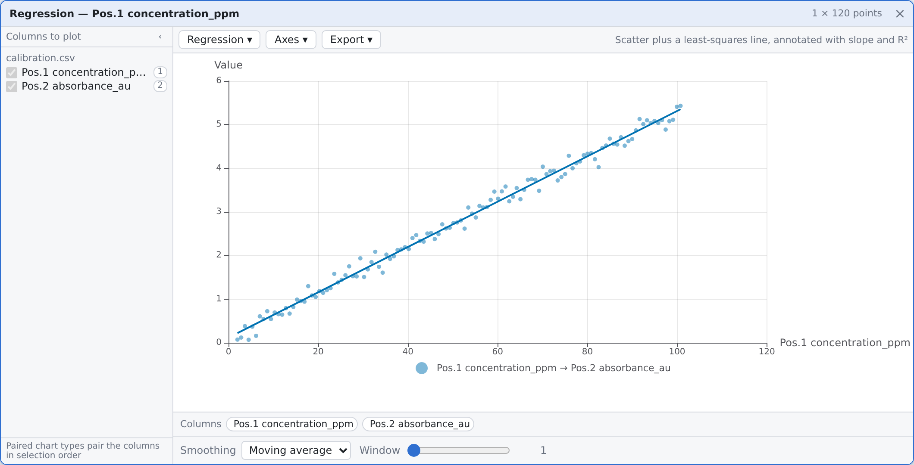
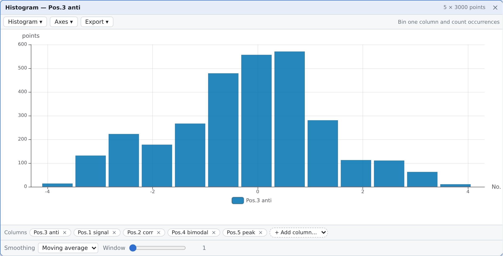
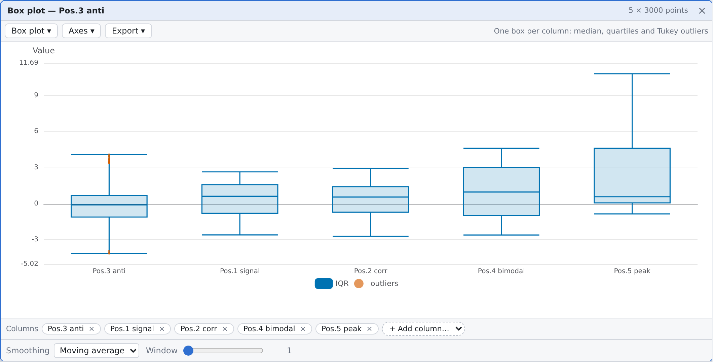
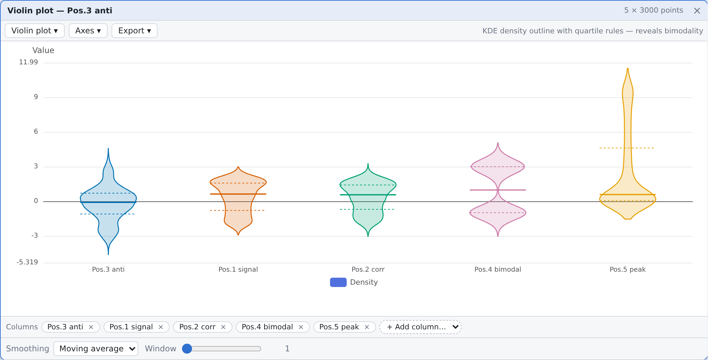
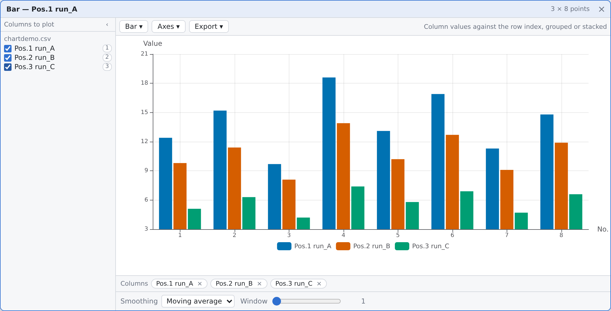
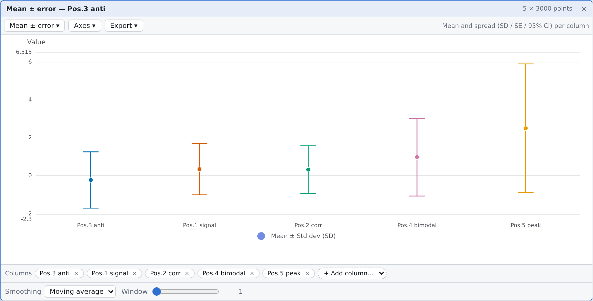
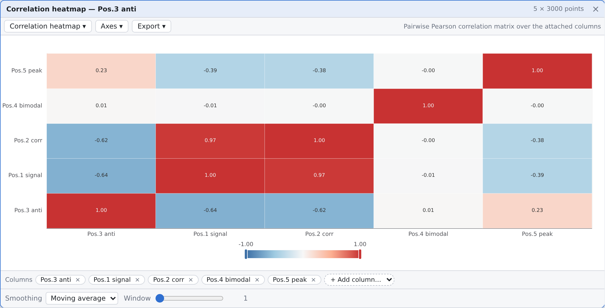

# DataCardForge — Data Matrix Workbench

[](https://github.com/DozenLow/DataCardForge/actions/workflows/ci.yml)
[-2ea44f)](https://dozenlow.github.io/DataCardForge/)
[](LICENSE)
[](web/tests)

**[English](README.md) | [中文](README.zh-CN.md)**

A lightweight **data matrix batch-processing workbench** for industrial / scientific scenarios:
drop a measurement file, get a card you can plot, transform and chain.

> ⚠️ **Early experimental project.** You can try the features and test workflows, but it is
> **not recommended** for production use or formal scientific research.

<p align="center">
  
</p>

**Author & provenance**: `DozenLow` · GPL-3.0 · see [`PROVENANCE.md`](PROVENANCE.md).
**Verified state**: 589 frontend unit tests (14 opt-in skipped) · 14 backend ctest cases
(4 opt-in) · 102 end-to-end smoke checks — all green.
**Not finished yet**: function cards are API-stable but UX-incomplete — see
[Known gaps](#known-gaps).

## Try it

**In the browser, no install** — <https://dozenlow.github.io/DataCardForge/> runs the React front end
as a static site. Drag [`docs/sampleData/1.txt`](docs/sampleData/1.txt) onto the canvas, then
right-click a column header → *Draw chart*. File loading and all nine chart types work there; the C++
compute service does not, so function cards show the "backend unreachable" banner — that is the
designed visible degradation, not a bug.
The demo URL only serves after Pages is enabled once: **Settings → Pages → Source: GitHub Actions**.

**From a release archive, no toolchain** — unzip `datacardforge-<os>-standard.zip` and run the binary:
it serves the bundled `web/` and opens the browser. On Windows the exe keeps a console window that
prints the address — closing it stops the service.

```bash
./datacardforge                 # serve on http://127.0.0.1:37811/ and open it
./datacardforge --no-open       # serve only (CI, servers, remote shells)
./datacardforge --open          # open the browser even when stdout is not a console
```

**Locally, with the compute backend** — install once, then one command builds the C++ service and
starts both servers:

```bash
cd web && npm install     # once, after cloning
./scripts/dev.sh          # builds backend → backend :37811 + Vite :5173
```

Requirements: Node 22.7+ (the opt-in fuzz gate needs `--experimental-transform-types`), CMake 3.24+,
a C++17 compiler and the Eigen 3.4 headers
(`sudo apt install build-essential cmake ninja-build libeigen3-dev`).

## Design Philosophy

- **Card model**: everything is a card — data card (file) → function card (transform) → output card (plot / export)
- **Strict separation**: data and behavior are separated; tables are never mutated; every transformation produces a new card
- **Connection subordination**: connections are only the visualization of data dependencies, kept low-key (background layer), and never interfere with card layout or interaction — cards are the protagonists, connections the supporting cast
- **Backend-owns-compute**: all numeric / statistical / matrix computation runs in the **C++/Eigen backend**; the browser is a **pure interaction surface** (rendering, input, layout). The backend being unreachable is a **visible state with a retry button**, never silent
- **Column-oriented matrix**: rows = samples (`No.N`), columns = variables (`Pos.N`), contiguous storage
- **Extensible**: computation system + adapter interfaces — the community can contribute long-tail features

## Architecture

```
┌─────────────────────────────────────────────────────┐
│                   Browser (Web)                     │
│  React 19 · ECharts 6 · zustand · VirtualTable      │
│  Card layout · Ports · Connections · Status lamps   │
│  Pure interaction — NO numeric computation          │
└──────────────────────┬──────────────────────────────┘
                       │ HTTP + JSON + DCM2 binary
                       ▼
┌─────────────────────────────────────────────────────┐
│              Compute Backend (C++17)                │
│  Eigen 3.4 · Expression engine · Dependency graph   │
│  Matrix store · Node scheduler · Event bus          │
│  All numeric / statistical / matrix computation     │
└─────────────────────────────────────────────────────┘
```

The frontend speaks [protocol v1](docs/architecture/backend-protocol-v1.md): JSON control messages over
HTTP plus DCM2 binary frames for dense-matrix windows (window + full shape). A long-poll event stream
pushes node state changes (dirty → computing → done | error) to drive the four-state status lamps.

## Features

### Data cards

- **File → Open Data Files**, **right-click the empty area**, or **drop files onto the canvas**
- Supports TXT / CSV / TSV / DAT / XLSX; parsing runs in a **Web Worker**, so a 10 000-row file does
  not freeze the interface; CSV parsing handles quoted fields and sniffs the delimiter
- **Automatic header detection**: a non-numeric first row becomes column titles (annotations)
- **Replace the data behind a card** (*Replace file…*, or drop a file onto it). Replacing is a **data
  change** — dependent cards follow and recompute; *switching* the file of a multi-file card is a
  **view change** and asks before re-pointing dependents
- File-backed tables start **read-only**; a lock button unlocks editing. Unparseable cells show `—`
  instead of silently becoming 0
- Values are displayed at their **shortest round-trip precision**, so a column of measurements around
  `1e6` stays readable instead of collapsing into one repeated string
- Loaded matrices are **registered with the compute backend** in the background; the UI never blocks

### Chart cards

- Right-click a column header → **pick the chart type directly** (types that would run past the last
  column are disabled, with the reason in the tooltip)
- **9 scientific chart types**, all SVG and therefore all exportable as **true vector**: line, scatter,
  **regression** (OLS with slope / R² / n), bar (grouped or stacked), **histogram** (Sturges auto-bin),
  **box plot** (median / quartiles / whiskers / Tukey outliers), **violin** (KDE + quartile rules),
  **mean ± error bars** (SD / SE / 95 % CI), **correlation heatmap** (pairwise Pearson)
- Log Y axis / second axis / fit line / reset-zoom appear only where the type supports them
- **Smoothing**: moving average / exponential / median / Savitzky–Golay, redrawn live
- **Export**: SVG (true vector) / PNG (1×/2×/4×) / PDF (raster wrapper, labelled as such in the UI)
- Zoom and pan on both axes; dependent charts follow file switches automatically

### Function cards

- **Dependencies live in the envelope**: `inputs[]` is the single dependency representation, so the
  graph rebuilds in one pass with no card-type knowledge
- **One node, K outputs**: a signature declares its ports and output count; `builtin:expression-columns`
  computes a whole wide table from one node
- **Inputs are explicit matrices**: switching a file never silently re-points a function card. The card
  shows a **pending offer** with a column-difference preview and one confirmation
- **Column-count contract**: naming an output column locks its width; upstream width drift makes the
  backend cut the flow (`columnContractViolation`) and clear the stale result
- **Results flow onward**: a function card's output is an ordinary matrix, so it can be plotted or fed
  into the next card and recomputes when anything upstream changes
- **A signature need not look like a formula card**: `builtin:linear-regression` has two single-column
  ports, no expression parameters and a fixed 1 × 5 output; x and y are chosen by **binding**, not by
  parameter
- **The manual lives in the UI**: the Help menu and the `?` on the formula zone open the same reference
  (cheat-sheet / column-reference syntax / examples); a test asserts the manual and the engine's
  function table are the same set

### Expression engine

The backend expression engine is a full semantic port of the TS reference — cross-tier JSON fixtures
plus a randomized differential fuzz gate guarantee identical results.

- Arithmetic, comparisons, aggregations (SUM / AVG / MIN / MAX / MEDIAN / STD / VAR / SEM, NaN-skipping
  and Bessel-corrected), element-wise math (ABS / SQRT / LOG / LN / LOG10 / EXP / POW / ROUND / FLOOR /
  CEIL / SIGN), moving window (MOV / EMA), conditionals (IF)
- **Column references**: `Pos.1` (case-insensitive), bare annotations, bracket-quoted verbatim names
  (`[地面速度_μm/s]`), and port qualification for multi-input cards (`A.pos.1`). Full-width punctuation
  is accepted as its ASCII equivalent
- **Matrix mode**: when any input variable is declared matrix-mode, `*` becomes matrix multiplication;
  additionally `TRANSPOSE` / `DET` / `INV` / `SOLVE` / `MMUL` / `EMUL`. Shape mismatches produce
  structured `shapeMismatch` errors — never silent garbage

### Canvas & interaction

- **Unbounded canvas + whole-workbench zoom**: wheel zooms everything anchored on the cursor (10 %–300 %);
  over a card the wheel still belongs to the card, and Ctrl/Cmd+wheel zooms there too
- **Pan**: middle-drag, space+left drag, or a left drag on the bare canvas
- **View → Reset View** fits the whole workflow; **Tile / Cascade** lay out inside the visible area
- **Connection layer**: one line per dependency edge, endpoints at card-window centres, a single cubic
  Bézier route; colour, dash pattern and flow direction all encode input vs output (colour-blind
  friendly); the layer is `pointer-events: none`, so it never steals input
- A table that still feeds a chart **refuses to close**, and its connections blink to explain why
- Runtime **Chinese/English switching**, **workspace persistence** (layout + dependencies + data), CSV export
- **Backend availability banner** with a retry button — never a blank screen

## Screenshots

Every image is real headless-Chromium output of the production build, not a mock-up
(more in [`web/docs/screenshots/`](web/docs/screenshots/), regenerated by `web/scripts/smoke.mjs`).

| | | |
|---|---|---|
|  |  |  |
| **Line** — one or more columns against the row index | **Scatter** — two columns paired as (X, Y) | **Regression** — scatter + OLS fit with slope and R² |
|  |  |  |
| **Histogram** — Sturges auto-binning or explicit bins | **Box plot** — median / quartiles / Tukey outliers | **Violin** — KDE outline; bimodality is visible |
|  |  |  |
| **Bar** — grouped or stacked | **Mean ± error** — SD / SE / 95 % CI per column | **Correlation heatmap** — pairwise Pearson |

## Scope & Limitations

- Internal data is stored as **IEEE 754 double** (~15–17 significant digits), consistent with Excel's
  native numeric model
- Suitable for batch processing and visualization of **floating-point numeric** data (sensors,
  measurements, experiments)
- ⚠️ **Not suitable** for exact decimal arithmetic (financial / accounting amounts) or
  arbitrary-precision computation — Excel and most similar tools cannot satisfy these either
- The compute backend is a **required dependency**: without it, file loading and chart rendering still
  work locally, but formula evaluation and matrix operations are unavailable (with a visible banner)

## Known gaps

The data model and the contracts are settled; what is missing is UI on top of them.

- **Per-signature parameter forms** — the parameter zone renders `params.formulas` only, so a signature
  whose parameters are not a formula list has no form yet
- **Output selector (K > 1)** — the card model carries one display cache, so only output 0 can be shown
- **Connection editing** — hover/selection of a single line, dragging a new line, and deleting one
  (disconnecting means editing data and wants an undo path)
- **Multi-file cards can only replace** the file, not append/remove a single one
- **Windows startup path** is verified by cross-compilation and an import-table assertion, not on a real
  machine

The current state, the next task and the open questions live in `STATE.md` at the repository root.

## Tech Stack

| Component | Purpose | Notes |
|-----------|---------|-------|
| React 19 + Vite 8 | UI framework and build | TypeScript 7, `strict` |
| ECharts 6.1 | Charts | **SVG renderer**, true vector export |
| react-rnd | Card drag / resize | |
| zustand 5 | State (card table + dependency graph) | |
| @e965/xlsx | Excel read | Loaded on demand |
| Hand-rolled virtual scrolling | Large-table rendering | No third-party dependency |
| Web Worker (`src/loaders/parse.worker.ts`) | Off-thread file parsing | Keeps the UI responsive |
| Node.js 22 | Frontend runtime, dev server, CI | CI pins `node-version: 22` |
| Vitest 5 + jsdom | Unit / DOM tests | 589 tests, 14 opt-in skipped |
| Playwright (Chromium) | End-to-end smoke | 102 checks against `vite preview` |
| **C++17** (verified with g++ 15) | Compute backend language | `CMAKE_CXX_STANDARD 17`, CMake 3.24+ + Ninja |
| **Eigen 3.4** | Linear algebra / matrix operations | Header-only, `find_package(Eigen3 REQUIRED NO_MODULE)` |
| **Native sockets (POSIX / Winsock)** | Backend HTTP server | Zero third-party networking deps |
| `dc_core` static library | Shared backend code | Linked by `dc_backend`, the test runners and `dc_bench` |
| `dc_bench` (std::chrono) | Engine benchmark harness | Backs `bench/budgets.json` |
| GitHub Actions | CI, multi-platform builds, Pages | `ci.yml` · `build-release.yml` · `static.yml` |

## Building & Running

### Prerequisites

**Frontend** (Node.js 22+):
```bash
cd web && npm install
```

**Backend** (Ubuntu / Debian):
```bash
sudo apt-get install build-essential cmake ninja-build libeigen3-dev
```

> On other platforms: any C++17 compiler + CMake 3.24+ + Eigen 3.4 headers will work.
> The toolchain is verified on Ubuntu with g++ 15.2, cmake 4.2, ninja 1.13.

### One-command dev

```bash
./scripts/dev.sh          # builds backend + starts both servers
```

This runs `cmake --build backend/build`, starts `dc_backend` on port 37811, and launches `vite dev`
with `/api` proxied to the backend. Ctrl-C kills both.

### Manual steps

```bash
# Backend
cmake -S backend -B backend/build -G Ninja
cmake --build backend/build
./backend/build/dc_backend --port 37811

# Frontend (in another terminal)
cd web
npm run dev               # dev server at http://localhost:5173
npm run build             # type check + production build → web/dist/
npm test                  # unit tests (vitest, includes cross-tier fixtures)
```

### Tests

```bash
# Frontend: typecheck + unit tests (includes the cross-tier differential fixtures)
cd web && npm run typecheck && npm test

# Backend: 14 ctest cases (cross-tier fixtures, matrix operators, node registry, card fixtures,
# static path rules, algebraic invariants, accuracy); 4 further gates are opt-in and skipped by default
cd backend && ctest --test-dir build --output-on-failure

# Opt-in gates: differential fuzz (random TS↔C++ cross-check) and HTTP stress
DC_RUN_FUZZ=1 ctest --test-dir build -R diff_fuzz --output-on-failure
DC_RUN_STRESS=1 ctest --test-dir build -R http_stress --output-on-failure

# End-to-end smoke: 102 checks against a production build
cd web && npm run build && npx playwright install chromium   # browser binary, once
npx vite preview --port 4173 &                              # serve web/dist
node scripts/smoke.mjs http://127.0.0.1:4173
```

### CI

Three workflows live in [`.github/workflows/`](.github/workflows/):

1. **[`ci.yml`](.github/workflows/ci.yml)** — on every push to `main` and every PR: `typecheck-and-test`
   (npm ci → typecheck → vitest → production build), `backend-test` (cmake configure + build → ctest),
   and `e2e-smoke` (Playwright Chromium against `vite preview`).
2. **[`build-release.yml`](.github/workflows/build-release.yml)** — a six-job matrix
   (Linux / macOS / Windows × Release / Debug) that builds and runs ctest, uploading each platform's
   binary as an artifact. Its `release` job only runs for `refs/tags/v*`, so **a push to `main` never
   publishes a release**.
3. **[`static.yml`](.github/workflows/static.yml)** — publishes the front end to GitHub Pages on pushes
   that touch `web/**`. Needs a one-time switch: **Settings → Pages → Source: GitHub Actions**.

### Release artifacts

Pushing a `v*` tag publishes nine backend archives plus `README.txt` and `SHA256SUMS.txt`:

| Asset | Build | What it is for |
|---|---|---|
| `datacardforge-<os>-standard.zip` | `-O2 -g`, `NDEBUG` undefined → assertions on | **download this one** |
| `datacardforge-<os>-fullperformance.zip` | `-O3 -DNDEBUG` | fastest; what the tests and the perf gate measure |
| `datacardforge-<os>-debug.zip` | `-O0 -g` | reproducing a defect (tags only) |
