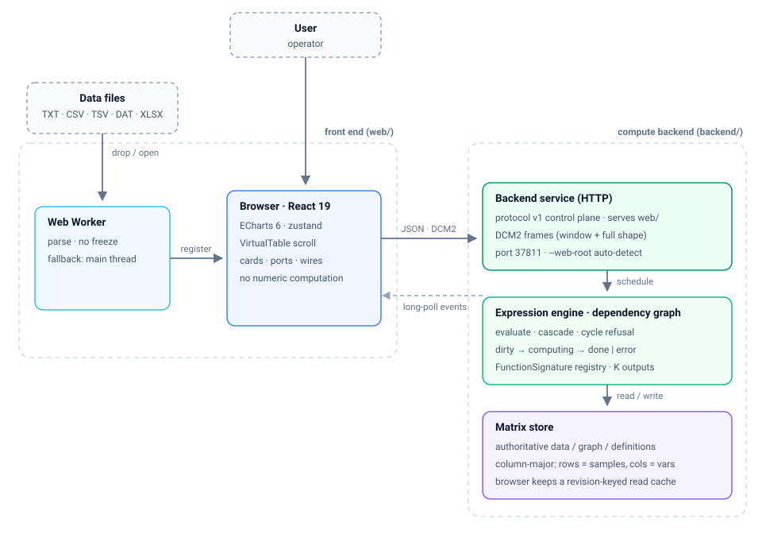

# DataCardForge — Data Matrix Workbench

[](https://github.com/DozenLow/DataCardForge/actions/workflows/ci.yml)
[-2ea44f)](https://dozenlow.github.io/DataCardForge/)
[](LICENSE)
[](web/tests)

**[English](README.md) | [中文](README.zh-CN.md)**

A lightweight **data matrix batch-processing workbench** for industrial / scientific scenarios:
drop a measurement file, get a card you can plot, transform and chain.

> ⚠️ **Early experimental project** (as of October 2026): you can try the features and test workflows,
> but it is **not recommended** for production use or formal scientific research.

<p align="center">
  
</p>

- **Author & provenance**: `DozenLow` · GPL-3.0 · identity, timeline and commit anchors in [`PROVENANCE.md`](PROVENANCE.md)
- **Verified state** (2026-11-03): 594 frontend unit tests (14 opt-in skipped) · 14 backend ctest cases
  (4 opt-in) · 102 end-to-end smoke checks — all green
- **Not finished yet**: function cards are API-stable but UX-incomplete; connection hover and
  disconnect-editing are not done. See [Known gaps](#known-gaps)

## Try it

**In the browser, no install** — <https://dozenlow.github.io/DataCardForge/> runs the React front end
as a static site. Drag [`docs/sampleData/1.txt`](docs/sampleData/1.txt) onto the canvas, then
right-click a column header → *Draw chart*. File loading and all nine chart types work there; the C++
compute service does not, so function cards show the "backend unreachable" banner — the designed
visible degradation, not a bug.
The demo URL only serves after Pages is enabled once: **Settings → Pages → Source: GitHub Actions**.

**From a release archive, no toolchain** — unzip `datacardforge-<os>-standard.zip` and run the binary:
it serves the bundled `web/` and opens the browser. On Windows the exe is deliberately a **console
program**: double-clicking gives you a window that prints the address and stays open (closing it stops
the service), plus a browser tab.

```bash
./datacardforge                 # serve on http://127.0.0.1:37811/ and open it
./datacardforge --no-open       # serve only (CI, servers, remote shells)
./datacardforge --open          # open the browser even when stdout is not a console
```

When the browser does not appear, the window states why (`--no-open`, `DC_NO_OPEN`, `web/` not found,
console not interactive) and prints the address to open manually.

**Locally, with the compute backend** — install once, then one command builds the C++ service and
starts both servers:

```bash
cd web && npm install     # once, after cloning
./scripts/dev.sh          # builds backend → backend :37811 + Vite :5173
```

Requirements: Node 22.7+ (the opt-in fuzz gate needs `--experimental-transform-types`), CMake 3.24+,
a C++17 compiler and the Eigen 3.4 headers
(`sudo apt install build-essential cmake ninja-build libeigen3-dev`).

## Design Philosophy

- **Card model**: everything is a card — data card (file) → function card (transform) → output card (plot / export)
- **Strict separation**: data and behavior are separated; tables are never mutated; every transformation produces a new card
- **Connection subordination**: connections only visualize data dependencies, live on the background
  layer and never interfere with card layout or interaction ([decision](docs/decisions/2026-08-07-connection-subordination.md))
- **Backend-owns-compute**: all numeric / statistical / matrix computation runs in the C++/Eigen
  backend; the browser is a pure interaction surface. An unreachable backend is a visible state with a
  retry button, never silent ([decision](docs/decisions/2026-10-17-backend-owns-compute.md))
- **Column-oriented matrix**: rows = samples (`No.N`), columns = variables (`Pos.N`), contiguous storage
- **Extensible**: operator system + adapter interfaces — the community can contribute long-tail features

## Architecture



Source: [`docs/diagrams/architecture.en.svg`](docs/diagrams/architecture.en.svg) · interactive version: [`docs/diagrams/interactive.html`](docs/diagrams/interactive.html) (open locally).

The frontend speaks [protocol v1](docs/architecture/backend-protocol-v1.en.md): JSON control messages
over HTTP plus DCM2 binary frames for dense-matrix windows (window + full shape). A long-poll event
stream pushes node state changes (dirty → computing → done | error) to drive the four-state status lamps.

## Features

### Data cards

- **File → Open Data Files**, right-click the empty area, or drop files onto the canvas; multiple files
  create **one card** with a dropdown to switch the active file
- **Replace the data behind a card** (*Replace file…*, or drop a file onto it): replacing is a **data
  change** — dependent cards follow and recompute; *switching* the file of a multi-file card is a
  **view change** and asks before re-pointing dependents

<details>
<summary>Formats and sniffing · header detection · read-only/editing · Web Worker parsing · parse cache · precision · backend registration</summary>

- Supports TXT / CSV / TSV / DAT / XLSX; CSV parsing handles quoted fields and sniffs the delimiter
- **Automatic header detection**: a non-numeric first row becomes column titles (annotations)
- File-backed tables start **read-only**; a lock button unlocks editing. Unparseable cells show `—`
  instead of silently becoming 0; non-numeric input is rejected with a message
- Parsing runs in a **Web Worker**, so a 10 000-row file does not freeze the interface (falls back to
  the main thread where Workers are unavailable)
- Re-opening the same file reuses the parse only when the bytes match (`size` + `lastModified`);
  a same-named file with different content is re-parsed
- Values display at their **shortest round-trip precision**, so a column of measurements around
  `1e6` stays readable instead of collapsing into one repeated string
- Loaded matrices are **registered with the compute backend** in the background (fire-and-forget;
  the UI never blocks on the network)

</details>

### Chart cards

- Right-click a column header → **pick the chart type directly** (types that would run past the last
  column are disabled, with the reason in the tooltip)
- **9 scientific chart types**, all SVG-rendered and therefore all exportable as **true vector**

<details>
<summary>Nine chart types · multi-column and switching · axis options · smoothing · export · zoom</summary>

- Line, scatter, **regression** (OLS + slope + R² + n), bar (grouped/stacked), **histogram**
  (Sturges auto-bin or explicit), **box plot** (median / quartiles / whiskers + Tukey outliers),
  **violin** (KDE density outline + quartile rules), **mean ± error bars** (SD / SE / 95 % CI,
  adjustable cap width), **correlation heatmap** (pairwise Pearson, diverging palette)
- Chart types switch in place; one chart can carry multiple columns (scatter/regression pair as (X,Y))
- Log Y axis / second axis / fit line / X-axis source / reset-zoom appear only where the type supports them
- **Smoothing**: moving average / exponential / median / Savitzky–Golay, redrawn live; settings survive
  data-source switches
- **Export**: SVG (live-DOM serialization, no embedded raster) / PNG (1×/2×/4×) / PDF (raster wrapper,
  labelled as non-vector in the UI)
- Zoom and pan on both axes (wheel or drag); dependent charts follow file switches, keeping old data
  when a column disappears

> Statistics live in `core/stats.ts`: pure functions, 40 unit tests, numeric conventions matching
> NumPy/R (linear-interpolation quantiles, Bessel-corrected variance, Silverman bandwidth,
> t-distribution confidence intervals, Tukey outliers).

</details>

### Function cards

- **Dependencies live in the envelope**: `inputs[]` is the single dependency representation, so the
  graph rebuilds in one pass with no card-type knowledge; one signature (`FunctionSignature`) node
  can have K outputs
- **Results flow onward**: a function card's output is an ordinary matrix, so it can be plotted or fed
  into the next card, and recomputes when anything upstream changes

<details>
<summary>Explicit inputs · column-count contract · 100-row preview · no evaluation lock · relation-enumeration card · cross-tier judge · in-UI manual</summary>

- **Inputs are explicit matrices**: switching a file never silently re-points a function card. The card
  shows a pending offer with a column-difference preview and one confirmation (batch included); only
  the confirmation writes to the graph. The offer box is a flashing yellow gradient (distinguishable
  from the selection state) and stops flashing under "reduce motion"
- **Column-count contract**: naming an output column locks its width; upstream width drift makes the
  backend cut the flow (`columnContractViolation`) and clear the stale result (downstream shows
  "invalidated"); self-edits go through "extend contract / unlock"
- **Result preview** renders the first 100 rows by default while the frame reports the full-table
  shape (e.g. 10 000 rows)
- **No evaluation lock**: a slow function never freezes the node registry (maximum-headroom principle)
- **A signature need not look like a formula card**: `builtin:linear-regression` has two single-column
  ports, no expression parameters and a fixed 1 × 5 output; x / y are chosen by column **binding**
  (recomputed immediately). In the result table, rows = column-pair relations
  (e.g. `滑油压力_MPa：推力_kN`), columns = statistics (slope / intercept / r / R² / n, full relation
  name on header hover); column widths drag from the header edge; the formula zone is replaced by a
  "computation notes" panel
- **Cross-tier judge**: the same JSON in `web/tests/fixtures/cards/*.json` runs through both TS and
  C++; `DC_RUN_INTEGRATION=1` adds a real-backend integration gate
- **The manual lives in the UI**: the Help menu and the `?` on the formula zone open the same reference
  (cheat-sheet / column-reference syntax / examples / common errors), asserted by tests to match the
  engine's function table; "available columns" are clickable chips that insert `Pos.N` at the cursor;
  hovering for 1 s shows a tooltip at the pointer (not a native `title`)

</details>

### Compute backend (C++/Eigen)

The backend holds the **authoritative copy** of all data, the dependency graph and computation
definitions; the browser keeps only a read-only display cache keyed by revision.

- **Protocol v1**: HTTP/1.1 + JSON control plane + DCM2 binary matrix frames (window + full shape) +
  long-poll events; version handshake on connect, mismatch → visible banner

<details>
<summary>Expression engine and column references · matrix mode · dependency graph · node state machine · cross-tier fixtures</summary>

- The expression engine is a semantics-by-semantics port of the TS reference: 81 expression fixtures +
  14 matrix fixtures + a randomized differential fuzz gate (`DC_RUN_FUZZ=1`). Supports arithmetic,
  comparisons, aggregations (SUM / AVG / MIN / MAX / MEDIAN / STD, NaN-skipping, Bessel-corrected STD),
  element-wise math (ABS / SQRT / LOG / LN / LOG10 / EXP / POW / ROUND / FLOOR / CEIL / SIGN),
  moving windows (MOV / EMA), conditionals (IF)
- **Column references**: `Pos.1` (case-insensitive), bare annotation names (`时间_秒`), bracket-quoted
  verbatim names (`[地面速度_μm/s]` — the only form for names with `/`, spaces or parentheses), and
  port qualification for multi-input cards (`A.pos.1`, `src.时间_秒`, `A.[…]`); full-width punctuation
  is accepted as its ASCII equivalent. See the
  [decision](docs/decisions/2026-10-28-expression-reference-syntax.md)
- **Matrix mode**: when any input variable is declared matrix-mode, `*` becomes matrix multiplication;
  additionally `TRANSPOSE` / `DET` / `INV` / `SOLVE` / `MMUL` (explicit matrix product) / `EMUL`
  (explicit element-wise product). Shape mismatches produce structured `shapeMismatch` errors —
  never silent garbage
- **Dependency graph**: port-level edges, atomic cycle rejection (N edges are added all-or-none),
  result-matrix-aware cascades via the `resultOwner_` mapping
- **Node state machine**: dirty → computing → done | error, pushed over an event stream with a
  monotonically increasing seq

> The cross-tier fixtures (`web/tests/fixtures/xlayer/`) are the only judge format: the TS reference
> and the C++ engine must both pass the same JSON — enforced in CI.

</details>

### Connection layer

- **One line per dependency edge** (table→function card, function card→function card, table/function
  card→chart); endpoints are the **centres of the two card windows**, the in-card segment is swallowed
  by a mask so the visible part starts at the card border
- The whole line is a single cubic Bézier; red = source card selected (long dashes), blue = target
  card selected (short dashes), grey = neither (thin solid), and red/blue lines flow toward the target

<details>
<summary>Bézier geometry · triple encoding · arrows and portId · tracking and tweening · pointer-events · zoom invariance</summary>

- Control points blend between the horizontal and vertical solutions by `|dx|/(|dx|+|dy|)`, so dragging
  diagonally across 45° never flips or jumps
- Colour + flow direction + long/short dash pattern triple-encode input vs output (colour-blind friendly)
- Arrows stop outside the target card's border; when the whole line is swallowed by the target card,
  no arrow is drawn
- With a card selected, the visible-segment midpoint shows the carried `portId` (multi-ports collapse
  to `+N`)
- Layout-version-driven live tracking (no timer polling); table scrolling does not move lines; whole-card
  jumps (tile/cascade/load/undo) tween over 220 ms, compressed to 70 ms when the tween would sweep
  across a third card
- The layer is `pointer-events: none`: it never steals input and never participates in layout
- Line width, dash length and flow period scale by `1/zoom`, so on-screen size is constant across
  10 %–300 % zoom

</details>

### Canvas & interaction

- **Unbounded canvas + whole-workbench zoom**: the wheel zooms everything anchored on the cursor
  (cards, text, charts, connections; 10 %–300 %). Over a card the wheel still belongs to the card
  (table scroll, chart zoom); Ctrl/⌘+wheel and trackpad pinch zoom there too
- **Pan**: middle-drag, space+left drag, or a left drag on the bare canvas; **View → Reset View**
  fits the whole workflow (auto-zoom and centre)

<details>
<summary>Tile/cascade · close protection · i18n and persistence · availability banner</summary>

- **Tile / Cascade** lay out inside the visible area; **Close all** also available
- A table/card that still feeds a dependent **refuses to close**, and its connections blink to explain why
- Runtime **Chinese/English switching**; **workspace persistence** (save/restore layout + dependencies +
  data); tables export to CSV
- When the backend is unreachable or the version mismatches, a warning bar with a retry button appears —
  never a blank screen
- The rationale for the canvas view model is in the
  [decision record](docs/decisions/2026-10-21-infinite-canvas.md)

</details>

## Screenshots

Every image is real headless-Chromium output of the production build, not a mock-up
(more in [`web/docs/screenshots/`](web/docs/screenshots/), regenerated by `web/scripts/smoke.mjs`).

| | | |
|---|---|---|
|  |  |  |
| **Line** — one or more columns against the row index | **Scatter** — two columns paired as (X, Y) | **Regression** — scatter + OLS fit with slope and R² |
|  |  |  |
| **Histogram** — Sturges auto-binning or explicit bins | **Box plot** — median / quartiles / Tukey outliers | **Violin** — KDE outline; bimodality is visible |
|  |  |  |
| **Bar** — grouped or stacked | **Mean ± error** — SD / SE / 95 % CI per column | **Correlation heatmap** — pairwise Pearson |

## Scope & Limitations

- Internal data is stored as **IEEE 754 double** (~15–17 significant digits), consistent with Excel's
  native numeric model
- Suitable for batch processing and visualization of **floating-point numeric** data (sensors,
  measurements, experiments)
- ⚠️ **Not suitable** for exact decimal arithmetic (financial / accounting amounts) or
  arbitrary-precision computation — Excel and most similar tools cannot satisfy these either
- The compute backend is a **required dependency**: without it, file loading and chart rendering still
  work locally, but formula evaluation and matrix operations are unavailable (with a visible banner)

## Known gaps

The data-card and chart pipelines are complete and gated; the card-graph layer is being finished.
The data model and the contracts are settled (see
[card contracts](docs/decisions/2026-10-27-card-contracts.md),
[schema v2](docs/decisions/2026-10-26-card-schema-v2.md)); what is missing is UI on top of them:

- **Function cards are API-stable, UX-incomplete**: no per-signature parameter forms (the parameter
  zone renders `params.formulas` only, so a signature whose parameters are not a formula list has no
  controls) and no output selector for K > 1 (only output 0 is visible)
- **Connection editing**: hover/selection of a single line, deleting one (disconnecting means editing
  data and wants an undo path) and dragging a new line are all undone; the port dots (`portAnchor`)
  are reserved for this
- **Multi-file cards can only replace** the file, not append/remove a single one; there is no global
  undo stack
- The **Windows startup path** is verified by cross-compilation and an import-table assertion, not on a
  real machine

The current state, the next task and the open questions live in `STATE.md` at the repository root.

## Tech Stack

| Component | Purpose | Notes |
|-----------|---------|-------|
| React 19 + Vite 8 | UI framework and build | TypeScript 7, `strict` |
| ECharts 6.1 | Charts | **SVG renderer**, true vector export |
| react-rnd | Card drag / resize | |
| zustand 5 | State (card table + dependency graph) | |
| @e965/xlsx | Excel read | Loaded on demand |
| Hand-rolled virtual scrolling | Large-table rendering | No third-party dependency |
| Web Worker (`src/loaders/parse.worker.ts`) | Off-thread file parsing | Keeps the UI responsive |
| Node.js 22 | Frontend runtime, dev server, CI | CI pins `node-version: 22`; the opt-in fuzz gate needs `--experimental-transform-types` |
| Vitest 5 + jsdom | Unit / DOM tests | 594 tests, 14 opt-in skipped |
| Playwright (Chromium) | End-to-end smoke | 102 checks against `vite preview` |
| **C++17** (verified with g++ 15) | Compute backend language | `CMAKE_CXX_STANDARD 17`, CMake 3.24+ + Ninja |
| **Eigen 3.4** | Linear algebra / matrix operations | Header-only, `find_package(Eigen3 REQUIRED NO_MODULE)` |
| **Native sockets (POSIX / Winsock)** | Backend HTTP server | Zero third-party networking deps; links `ws2_32` on Windows |
| `dc_core` static library | Shared backend code | Linked by `dc_backend`, the test runners and `dc_bench` |
| `dc_bench` (std::chrono) | Engine benchmark harness | Backs `bench/budgets.json`, no third-party benchmark framework |
| GitHub Actions | CI, multi-platform builds, Pages | `ci.yml` · `build-release.yml` · `static.yml` |

## Building & Running

### Prerequisites

**Frontend** (Node.js 22+):
```bash
cd web && npm install
```

**Backend** (Ubuntu / Debian):
```bash
sudo apt-get install build-essential cmake ninja-build libeigen3-dev
```

> On other platforms: any C++17 compiler + CMake 3.24+ + Eigen 3.4 headers will work.
> The toolchain is verified on Ubuntu 26.04 (g++ 15.2, cmake 4.2, ninja 1.13).

### One-command dev

```bash
./scripts/dev.sh          # builds backend + starts both servers
```

This runs `cmake --build backend/build`, starts `dc_backend` on port 37811, and launches `vite dev`
with `/api` proxied to the backend. Ctrl-C kills both.

### Manual steps

```bash
# Backend
cmake -S backend -B backend/build -G Ninja
cmake --build backend/build
./backend/build/dc_backend --port 37811

# Frontend (in another terminal)
cd web
npm run dev               # dev server at http://localhost:5173
npm run build             # type check + production build → web/dist/
npm test                  # unit tests (vitest, includes cross-tier fixtures)
```

### Tests

```bash
# Frontend: typecheck + 594 unit tests (includes 81 cross-tier differential fixtures, 14 opt-in skipped)
cd web && npm run typecheck && npm test

# Backend: 14 ctest cases (cross-tier fixtures, matrix operators, node registry, card fixtures,
# static path rules); 4 further gates are opt-in and skipped by default
cd backend && ctest --test-dir build --output-on-failure

# Opt-in gates: differential fuzz (random TS↔C++ cross-check) and HTTP stress
DC_RUN_FUZZ=1 ctest --test-dir build -R diff_fuzz --output-on-failure
DC_RUN_STRESS=1 ctest --test-dir build -R http_stress --output-on-failure

# End-to-end smoke: 102 checks against a production build
cd web && npm run build && npx playwright install chromium   # browser binary, once
npx vite preview --port 4173 &                              # serve web/dist
node scripts/smoke.mjs http://127.0.0.1:4173
```

### CI

Three workflows live in [`.github/workflows/`](.github/workflows/):

1. **[`ci.yml`](.github/workflows/ci.yml)** — on every push to `main` and every PR:
   `typecheck-and-test` (npm ci → typecheck → vitest → production build), `backend-test`
   (cmake configure + build → ctest), and `e2e-smoke` (Playwright Chromium against `vite preview`).
2. **[`build-release.yml`](.github/workflows/build-release.yml)** — a six-job matrix
   (Linux / macOS / Windows × Release / Debug) that builds and runs ctest, uploading each platform's
   binary as an artifact. Its `release` job only runs for `refs/tags/v*`, so **a push to `main` never
   publishes a release**; release notes are extracted from `CHANGELOG.md`.
3. **[`static.yml`](.github/workflows/static.yml)** — publishes the front end to GitHub Pages on pushes
   that touch `web/**` (the online demo above). Needs the one-time switch
   **Settings → Pages → Source: GitHub Actions**.

### Release artifacts

Pushing a `v*` tag publishes nine backend archives plus `README.txt` and `SHA256SUMS.txt`:

| Asset | Build | What it is for |
|---|---|---|
| `datacardforge-<os>-standard.zip` | `-O2 -g`, `NDEBUG` undefined → Eigen assertions on | **download this one**: near-release speed, but contract violations stop on the spot instead of computing wrong numbers |
| `datacardforge-<os>-fullperformance.zip` | `-O3 -DNDEBUG` | performance ceiling; what the tests and the perf gate measure |
| `datacardforge-<os>-debug.zip` | `-O0 -g` | reproducing a defect: 2–10× slower, never benchmark it (tags only) |

Every archive is "binary + `web/`": unzip, run, and it serves the UI from the same origin and opens
the browser. No runtime installation is needed — libstdc++/libgcc are statically linked on Linux, the
MSVC runtime is static (`/MT`) on Windows, and Eigen is header-only. Full details in
[`.github/release-assets.md`](.github/release-assets.md).

## Extension points

- `backend/src/expression.cpp` → expression engine (cell-mode + matrix-mode evaluators)
- `backend/src/matrix_value.h` → MatVal type wrapping Eigen::MatrixXd with enforced shape checks
- `backend/src/nodes.cpp` → compute node registry, dependency graph, scheduler
- `backend/src/http_server.cpp` → protocol v1 HTTP endpoints
- `web/src/backend/client.ts` → frontend transport client (protocol v1)
- `web/src/loaders/` → new file-format adapters (`FileLoader`)
- `web/src/core/MatrixData.ts` → client-side data model (display cache)
- `web/src/ui/ConnectionLayer.tsx` → connection visualization
- `web/tests/fixtures/xlayer/` → cross-tier differential fixtures (the only judge format)

## Roadmap

> Open items only; the completed ones are in the [project history](docs/history.en.md). Directions may
> change at any time — suggestions are welcome as
> [issues](https://github.com/DozenLow/DataCardForge/issues).

- Canvas minimap and zoom shortcuts (reusing the resetView framing computation)
- Windowed data source for VirtualTable: large matrices fetch by visible-row window instead of loading whole
- Data **editing** (non-file-backed cards: double-click edit + formula evaluation)
- Bidirectional connection highlighting (a single line currently shows only one of red/blue)
- Card polish: unified styling, spacing, palette and typography
- Conditional filter card: slice a matrix by row/column predicates before feeding a function card
- Extension card (ExtensionCard): a quick-parameter + live-preview panel attached to a parent card,
  created and closed with it — solving "parameters scattered across many cards"
- Summary panel (`builtin:summary`): descriptive statistics on any card, computed **only on request**;
  the payload is an ordinary matrix (rows = statistics, columns = variables). First batch of 12
  statistics and their definitions in the
  [decision record](docs/decisions/2026-10-27-summary-builtin.md)
- Implicit equation solving: extract B from A=B when B cannot be analytically isolated (a known
  limitation of the single-formula design)
- More smoothing modes; smoothing wired into formula/function cards
- Parallel execution of multiple function cards: backend scheduler + job ID + cancellation +
  out-of-order completion
- WebSocket upgrade: replace long polling with a persistent connection to cut state-push latency

## Acknowledgements

This project was developed with the assistance of **AI coding agents** (DeepSeek Harness / Claude and
similar tools, plus GitHub Copilot in the early phase). The author's parts: requirements, architecture
decisions (see [`docs/decisions/`](docs/decisions/)), acceptance criteria and test gates. The repository
makes no guarantee about "who typed the characters" — only about **reproducibility**: every feature
claim above is backed by unit tests / ctest cases / end-to-end checks (see "Tests"). Ownership and
timeline in [`PROVENANCE.md`](PROVENANCE.md).

## Contributing & Security

- **Contributing**: [CONTRIBUTING.md](CONTRIBUTING.md) — GPL-3.0, DCO 1.1 (sign every commit with
  `git commit -s`), the gates to run before opening a PR, and the contracts not to break.
- **Security**: [SECURITY.md](SECURITY.md) — how to report vulnerabilities privately, and which
  behaviors are design boundaries (no authentication, loopback-only bind, no HTTPS) rather than defects.
- **Changelog**: [CHANGELOG.md](CHANGELOG.md) (中文：[CHANGELOG.zh-CN.md](CHANGELOG.zh-CN.md)).

Both documents have Chinese versions: [CONTRIBUTING.zh-CN.md](CONTRIBUTING.zh-CN.md) ·
[SECURITY.zh-CN.md](SECURITY.zh-CN.md).

## License

DataCardForge is free software: you can redistribute it and/or modify it under the terms of the
**GNU General Public License version 3 (GPL-3.0)** as published by the Free Software Foundation.
The full license text is in [LICENSE](LICENSE).

### Third-party licenses

| Dependency | License | Notes |
|------|--------|------|
| React / Vite / ECharts / zustand / react-rnd | MIT / Apache-2.0 | Web frontend dependencies |
| @e965/xlsx | Apache-2.0 | SheetJS community build |
| Eigen 3.4 | MPL-2.0 | Header-only linear algebra (backend) |

*Qt-era dependencies (Qt 6, QCustomPlot, OpenXLSX, fast_float) were removed together with the Qt code
tree on 2026-10-15; the current C++ compute backend uses only Eigen and the standard library.*
