# DataCardForge — 数据矩阵工作台

[](https://github.com/DozenLow/DataCardForge/actions/workflows/ci.yml)
[](https://dozenlow.github.io/DataCardForge/)
[](LICENSE)
[](web/tests)

**[English](README.md) | [中文](README.zh-CN.md)**

面向工业/科研场景的轻量级**数据矩阵批处理工作台**：拖入测量文件，得到一张可绘图、可变换、可串接的卡片。

> ⚠️ **早期试验项目**（截至 2026 年 10 月）：可用来体验功能、测试使用流程，**强烈不建议**用于生产环境或正式科研。

<p align="center">
  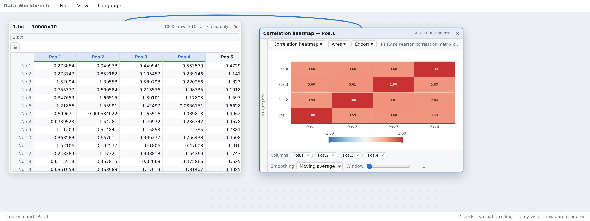
</p>

- **作者与权属**：`DozenLow` · GPL-3.0 · 身份、时间线与提交锚点见 [`PROVENANCE.md`](PROVENANCE.md)
- **实测状态**（2026-11-03）：前端 594 个单元测试（14 个 opt-in 跳过）· 后端 14 个 ctest（4 个 opt-in）· 端到端 102 项检查，全绿
- **尚未完成**：函数卡接口稳定、交互未收口；连线 hover 与断线编辑未做。见[状态与已知缺口](#状态与已知缺口)

## 试一下

**浏览器里直接用（无需安装）**——<https://dozenlow.github.io/DataCardForge/> 是前端的静态部署。把
[`docs/sampleData/1.txt`](docs/sampleData/1.txt) 拖进画布，右键列头 →「画图」。文件加载与 9 种图表可用；
C++ 计算服务不在静态托管上，函数卡会显示「后端不可达」横幅——这是设计内的可见降级，不是故障。
演示地址需先开启一次 **Settings → Pages → Source: GitHub Actions**，否则打开是 404。

**用发行包跑（无需工具链）**——解压 `datacardforge-<os>-standard.zip`，直接运行二进制：它用同源的
`web/` 提供界面并自动打开浏览器。Windows 的 `datacardforge.exe` 是刻意的**控制台程序**：双击会得到
一个打印着地址、停留不走的窗口（关掉即停止服务），同时打开浏览器标签页。

```bash
./datacardforge                 # 起在 http://127.0.0.1:37811/ 并打开浏览器
./datacardforge --no-open       # 只起服务（CI、服务器、远程 shell 用）
./datacardforge --open          # 即使 stdout 不是控制台也强制打开浏览器
```

浏览器没出现时，窗口会写明原因（`--no-open`、`DC_NO_OPEN`、没找到 `web/`、控制台不可交互）并给出手动打开的地址。

**本地跑完整版（含计算后端）**——先装一次依赖，然后一条命令编译后端并起两个服务：

```bash
cd web && npm install     # 克隆后执行一次
./scripts/dev.sh          # 编译后端 → 后端 :37811 + Vite :5173
```

前置：Node 22.7+（按需 fuzz 门控需要 `--experimental-transform-types`）、CMake 3.24+、C++17 编译器、
Eigen 3.4 头文件（`sudo apt install build-essential cmake ninja-build libeigen3-dev`）。

## 设计理念

- **卡片模型**：数据卡（文件）→ 函数卡（变换）→ 输出卡（绘图/导出），一切皆卡片
- **严格分离**：数据与行为分离，表永不改写，一切处理产出新卡片
- **连线从属**：连线只是数据依赖的可视化，常驻背景层，不干扰卡片布局与交互（[决策](docs/decisions/2026-08-07-connection-subordination.md)）
- **后端持有计算**：数值/统计/矩阵计算全部在 C++/Eigen 后端执行，浏览器是纯交互层；后端不可达是带重试按钮的可见状态，绝不静默（[决策](docs/decisions/2026-10-17-backend-owns-compute.md)）
- **列式矩阵**：行 = 样本（`No.N`），列 = 变量（`Pos.N`），连续内存存储
- **可扩展**：算子系统 + 适配器接口，长尾功能可由社区贡献

## 架构

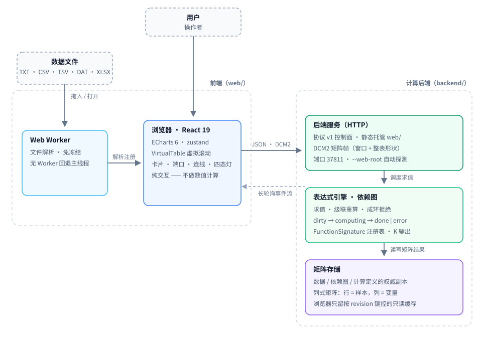

图源：[`docs/diagrams/architecture.zh.svg`](docs/diagrams/architecture.zh.svg) · 交互版见 [`docs/diagrams/interactive.html`](docs/diagrams/interactive.html)（本地打开）。

前端经[协议 v1](docs/architecture/backend-protocol-v1.md)通信：HTTP 上的 JSON 控制消息 + DCM2 二进制矩阵帧
（窗口 + 整表形状）。长轮询事件流推送节点状态变更（dirty → computing → done | error），驱动四态指示灯。

## 已实现功能

### 数据卡

- 菜单**文件 → 打开数据文件**、右键空白区域，或把文件直接拖入画布；多文件只建**一个卡片**，顶部下拉切换当前文件
- **换文件**（「替换文件…」或把文件拖到卡片上）是数据变更，下游函数卡与图表自动跟随重算；多文件卡里**切换**文件是视图变更，先询问再重指向下游

<details>
<summary>格式与嗅探 · 标题行 · 只读与编辑 · Worker 解析 · 解析缓存 · 精度显示 · 后端注册</summary>

- 支持 TXT / CSV / TSV / DAT / XLSX；CSV 支持引号转义与分隔符自动嗅探
- 首行非纯数字时识别为列标题（annotation）而非数据
- 文件来源的表格默认只读，卡片文件行的锁按钮可切换编辑；无法解析的单元格显示 `—`（不静默变 0），非数值输入被拒绝并提示
- 解析在 Web Worker 中进行，万行文件不冻结界面（无 Worker 环境回退主线程）
- 重新打开同一文件仅在字节一致（`size` + `lastModified`）时复用解析结果；同名不同内容会重新解析
- 数值按**最短往返精度**显示，`1e6` 量级的测量列不会整列渲染成同一个 `1e+6`
- 加载的矩阵自动注册到计算后端（fire-and-forget，UI 不因网络阻塞）

</details>

### 图表卡

- 右键列头**直接选图型**：列数不够的图型置灰，悬浮提示说明还差几列
- **9 种科研/统计图型**，全部 SVG 渲染、**全部可导出真矢量**

<details>
<summary>九种图型 · 多列与切换 · 轴选项 · 平滑 · 导出 · 缩放</summary>

- 折线、散点、回归（OLS + 斜率 + R² + n）、柱状（分组/堆叠）、直方图（Sturges 自动分箱或指定）、
  箱线图（中位数/四分位/须线 + Tukey 离群点）、小提琴图（KDE 密度轮廓 + 四分位线）、
  均值±误差棒（SD / SE / 95% CI，帽宽可调）、相关性热力图（两两 Pearson，发散配色）
- 图型可在卡片内随时切换；一个图表可挂多列（散点/回归按 (X,Y) 配对）
- 对数 Y 轴 / 次坐标轴 / 拟合线 / X 轴来源 / 重置缩放等选项按图型自动提供
- 平滑：滑动平均 / 指数 / 中值 / Savitzky–Golay，改动实时重绘，切换数据源时设置保留
- 导出：SVG（活 DOM 序列化、无内嵌位图）/ PNG（1×/2×/4×）/ PDF（位图封装，UI 明确标注非矢量）
- 两轴缩放/平移（滚轮或拖拽）；文件切换时依赖图表自动更新，列不存在时保留旧数据

> 统计量实现在 `core/stats.ts`：纯函数、40 个单元测试，数值约定与 NumPy/R 一致
> （线性插值分位数、Bessel 校正方差、Silverman 带宽、t 分布置信区间、Tukey 离群点）。

</details>

### 函数卡

- 依赖只在信封 `inputs[]` 上声明，依赖图重建一次遍历、零卡种知识；一个签名（`FunctionSignature`）节点可有 K 个输出
- 结果是普通矩阵：既能绘图，也能喂给下一张函数卡（链式），上游变更后自动重算

<details>
<summary>输入矩阵化 · 列数契约 · 预览 100 行 · 求值不持锁 · 关系枚举卡 · 跨层裁判 · 界面内说明</summary>

- 输入是显式矩阵：切数据卡里的文件不静默改函数卡输入，改用卡片级待处理提示 + 列差异预览 +
  一次确认（含批量），确认才写图。提示框黄底渐变 + 闪烁（与选中态可区分）；开启「减少动态效果」时停闪
- 列数契约：命名输出列即锁宽度；上游宽度漂移由后端 `columnContractViolation` 断流并清空旧结果
  （下游呈「失效」），自编辑走「扩展契约 / 解除锁定」
- 结果预览默认只渲染前 100 行，帧里同时报告整表形状（如 10000 行）
- 求值不持锁：慢函数不冻结节点注册表（最大余量原则）
- 签名可以完全不像公式卡：`builtin:linear-regression` 双单列端口、无表达式参数、输出固定 1 行 × 5 列；
  x / y 用列下拉**绑定**（改完立即重算）。结果表行轴 = 列对关系（如 `滑油压力_MPa：推力_kN`），
  列轴 = 统计量（斜率 / 截距 / r / R² / n，列头悬停带完整关系名），列宽可拖表头右缘调整；
  表达式区换成「计算说明」
- 跨层裁判：`web/tests/fixtures/cards/*.json` 同一份 JSON 由 TS 与 C++ 双边跑；
  `DC_RUN_INTEGRATION=1` 时另有真后端集成门禁
- 说明就在界面里：帮助菜单与公式区标题的 `?` 打开同一份说明（函数速查 / 列引用写法 / 示例 / 常见报错），
  测试断言说明与引擎函数表同源；「可用列」是可点芯片，点一下在光标处插入 `Pos.N`；
  悬停静止 1 s 在指针位置出提示（不用原生 `title`）

</details>

### 计算后端（C++/Eigen）

后端持有所有数据、依赖图和计算定义的**权威副本**；浏览器只保留按 revision 键控的只读显示缓存。

- **协议 v1**：HTTP/1.1 + JSON 控制面 + DCM2 二进制矩阵帧（窗口 + 整表形状）+ 长轮询事件；连接时版本握手，不匹配显示可见横幅

<details>
<summary>表达式引擎与列引用 · 矩阵模式 · 依赖图 · 节点状态机 · 跨层夹具</summary>

- 表达式引擎是 TS 参考实现的逐语义移植：81 个表达式夹具 + 14 个矩阵夹具 + 随机差分 fuzz（`DC_RUN_FUZZ=1`）
  保证一致。支持算术、比较、聚合（SUM/AVG/MIN/MAX/MEDIAN/STD，NaN 跳过 + Bessel 校正 STD）、
  逐元素数学函数（ABS/SQRT/LOG/LN/LOG10/EXP/POW/ROUND/FLOOR/CEIL/SIGN）、滑动窗口（MOV/EMA）、条件（IF）
- 列引用写法：`Pos.1`（大小写不敏感）、裸注解名（`时间_秒`）、方括号逐字引用（`[地面速度_μm/s]`，
  名字含 `/`、空格、括号时的唯一写法）、多输入端口限定（`A.pos.1`、`src.时间_秒`、`A.[…]`）；
  全角标点（`（）`、`，`、`×`、`／`、`－`）按 ASCII 等价物处理。见[决策](docs/decisions/2026-10-28-expression-reference-syntax.md)
- 矩阵模式：任一输入变量声明为矩阵模式时 `*` 变矩阵乘法；另有 `TRANSPOSE` / `DET` / `INV` / `SOLVE` /
  `MMUL`（显式矩阵乘）/ `EMUL`（显式逐元素乘）。形状不匹配产生结构化 `shapeMismatch` 错误，绝不静默出垃圾结果
- 依赖图：按端口的边、原子成环拒绝（N 条边要么全加要么全不加）、经 `resultOwner_` 映射的结果矩阵感知级联
- 节点状态机：dirty → computing → done | error，经单调递增 seq 的事件流推送

> 跨层测试夹具（`web/tests/fixtures/xlayer/`）是唯一裁判格式：TS 参考实现与 C++ 引擎必须通过
> 同一份 JSON，CI 强制执行。

</details>

### 连线可视化

- **一条依赖边一根线**（表→函数卡、函数卡→函数卡、表/函数卡→图表）；端点是两张卡片窗口的**中心**，卡片内那段被遮罩吞掉，可见段从卡片边框开始
- 整条线是一条三次贝塞尔；红色 = 源卡片选中（长划虚线）、蓝色 = 目标卡片选中（短划虚线）、灰色 = 都未选中（细实线），红蓝线朝目标流动

<details>
<summary>贝塞尔几何 · 三重编码 · 箭头与 portId · 跟随与补间 · pointer-events · 缩放恒定</summary>

- 控制点按 `|dx|/(|dx|+|dy|)` 在水平/垂直解之间混合，斜向拖动越过 45° 不翻折突跳
- 颜色 + 流向 + 长/短虚线三重编码输入/输出（色觉障碍友好）
- 箭头停在目标卡片边框外；整条线被目标卡吞掉时不画箭头
- 选中卡片时，可见段中点标出携带的 `portId`（多端口折叠显示 `+N`）
- 布局版本号驱动实时跟随（非定时器轮询）；表格滚动不移动连线；整卡跳变（平铺/层叠/载入/撤销）
  做 220ms 补间，补间扫过第三张卡时整段压到 70ms
- 连线层 `pointer-events: none`：永不抢事件、不参与布局
- 线宽、虚线段长、流动周期按 `1/zoom` 计算，10%–300% 缩放下屏幕尺寸恒定

</details>

### UI 与交互

- **无边界画布 + 整体缩放**：滚轮围绕光标缩放整个工作台（卡片、文字、图表、连线一起，10%–300%）；指针在卡片上时滚轮仍归卡片（表格滚动、图表缩放），按住 Ctrl/⌘ 或触控板捏合亦可缩放
- **平移**：中键拖动、空格+左键拖动、空白处左键拖动；菜单**视图 → 回到卡片**一键适应内容（自动缩放并居中）

<details>
<summary>平铺/层叠 · 关闭保护 · 中英切换与工作区持久化 · 后端可用性横幅</summary>

- 平铺 / 层叠在可见区域内排布，另有关闭全部
- 有下游依赖的表格/卡片拒绝关闭并提示，同时闪烁其连线
- 运行时中英切换；工作区持久化（保存/恢复布局 + 依赖 + 数据）；表格导出 CSV
- 后端不可达或版本不匹配时显示带重试按钮的警告条，绝不白屏
- 画布视图模型的论证见[决策](docs/decisions/2026-10-21-infinite-canvas.md)

</details>

## 截图

下面每张图都是生产构建在 headless Chromium 里的真实输出，不是示意图（更多见
[`web/docs/screenshots/`](web/docs/screenshots/)，由 `web/scripts/smoke.mjs` 可复现生成）。

| | | |
|---|---|---|
| 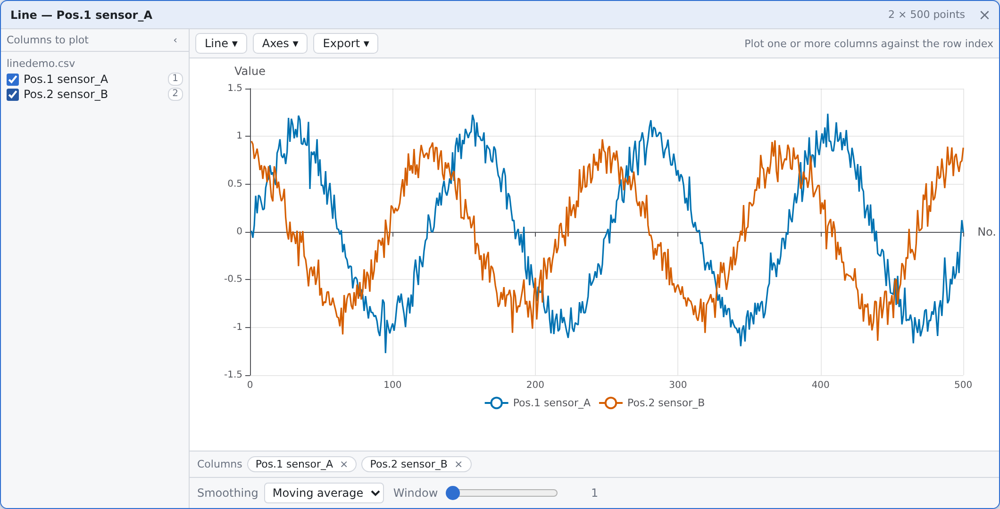 | 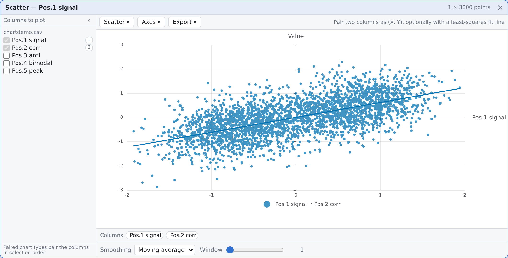 | 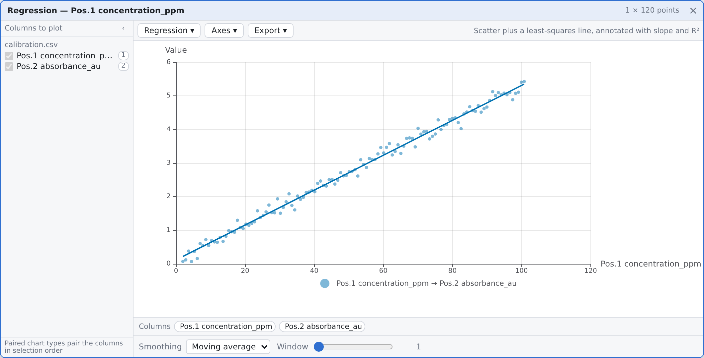 |
| **折线图**——一列或多列按行号展开，可缩放/对数轴/平滑 | **散点图**——两列配对 (X, Y)，可叠加最小二乘线 | **回归图**——散点 + OLS 拟合，标注斜率与 R² |
| 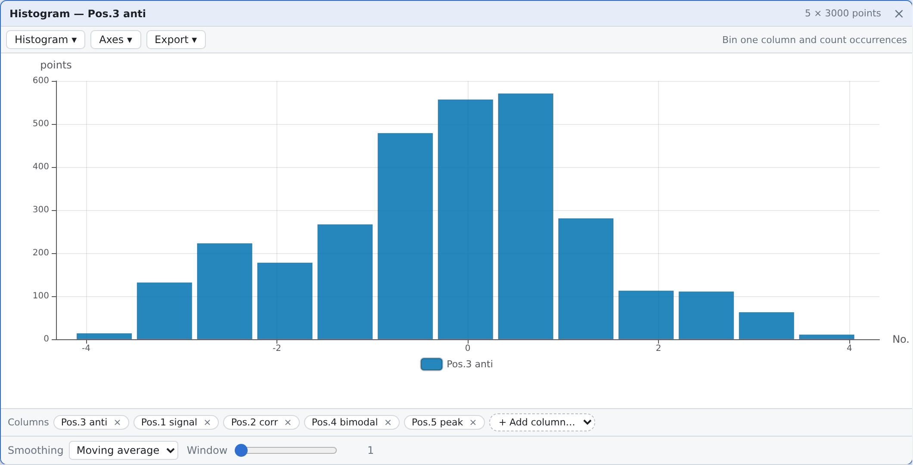 | 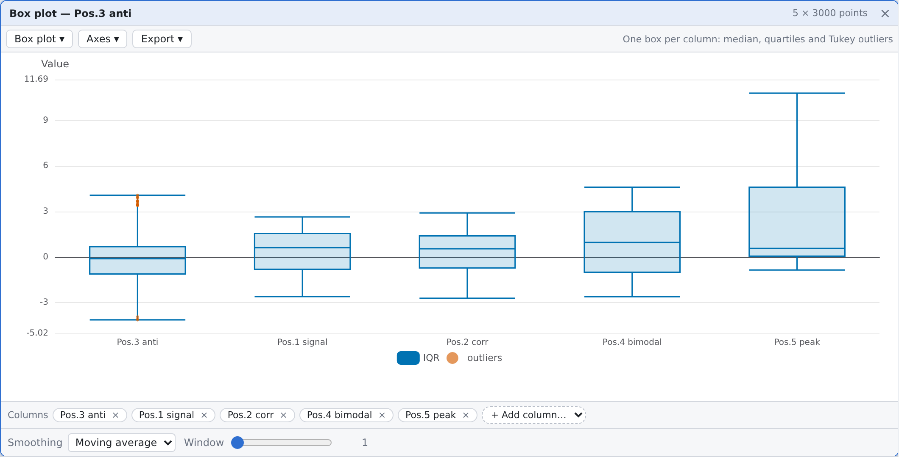 | 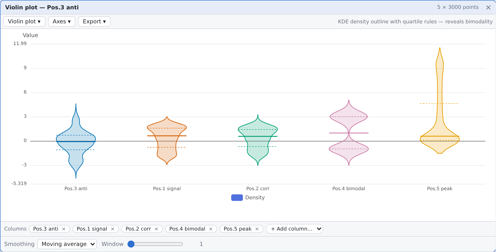 |
| **直方图**——Sturges 自动分箱或显式指定箱数 | **箱线图**——中位数/四分位/须线/Tukey 离群点 | **小提琴图**——KDE 轮廓 + 四分位线，双峰结构清晰 |
| 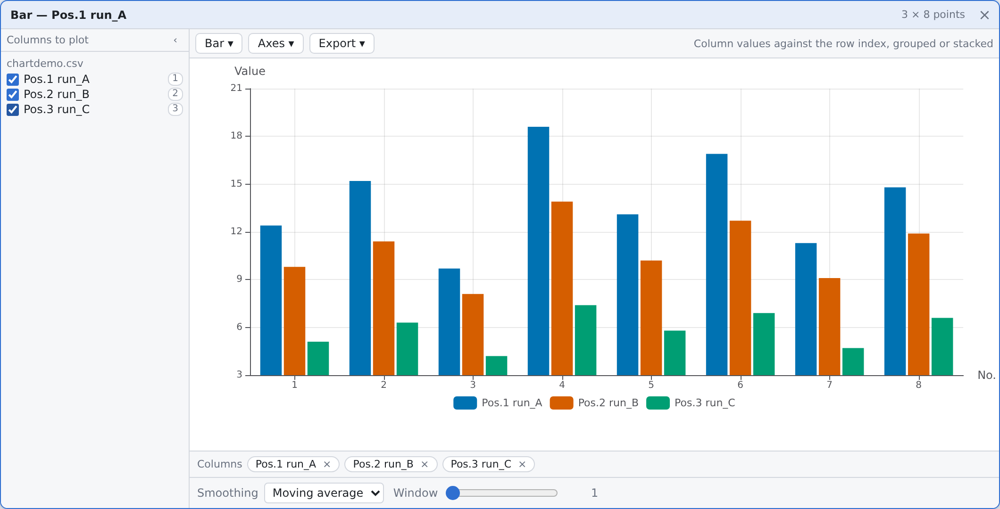 | 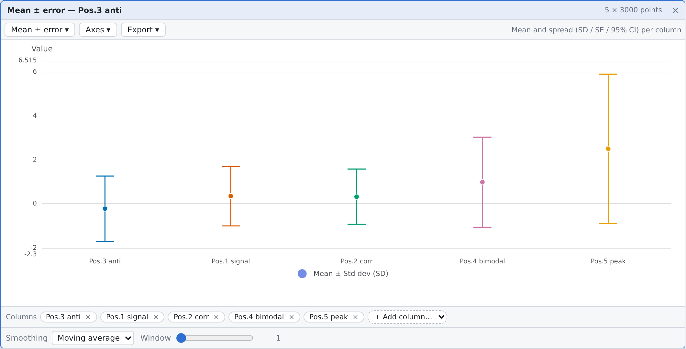 | 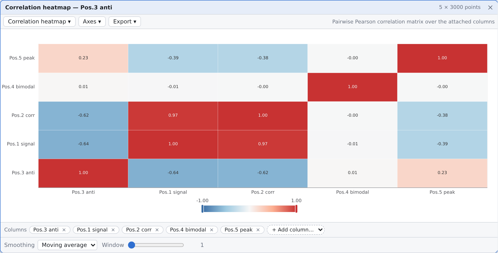 |
| **柱状图**——分组/堆叠，按行号展开 | **均值±误差**——每列均值 + SD/SE/95% CI | **相关性热力图**——两两 Pearson 矩阵 |

## 适用范围与限制

- 内部数值用 **IEEE 754 double**（约 15~17 位有效数字）存储，与 Excel 原生数值模型一致
- 适用于传感器、测量、实验等**浮点数值**数据的批量处理与可视化
- ⚠️ **不适用**于需要十进制精确运算（如金融/会计金额）或任意精度计算的场景——Excel 与多数同类工具同样无法满足
- 计算后端是**必需依赖**：没有它时文件加载和图表渲染仍可本地工作，但公式求值和矩阵运算不可用（带可见横幅提示）

## 状态与已知缺口

数据卡与图表链路已完整并有门禁；卡片图这一层还在收尾。数据模型与契约已定死
（见[`卡片契约`](docs/decisions/2026-10-27-card-contracts.md)、[`schema v2`](docs/decisions/2026-10-26-card-schema-v2.md)），
缺的是它们之上的 UI：

- **函数卡接口稳定、交互未收口**：缺按签名渲染的参数表单（参数区目前只认 `params.formulas`，
  非公式列表的签名没有控件可渲染）与 K > 1 的多输出选择器（目前只能看第 0 个输出）
- **连线编辑**：hover/点选单条线、删除单条线（断线等于改数据，需要撤回路）、拖拽建线均未做；
  端口圆点（`portAnchor`）是为其预留的
- **多文件卡只能「换」**，不能追加/删除单个文件；全局无撤销栈
- **Windows 启动链**只验证到交叉编译 + 导入表断言，真机双击未复测

当前状态、下一个任务与开放问题见仓库根 `STATE.md`。

## 技术栈

| 组件 | 用途 | 备注 |
|------|------|------|
| React 19 + Vite 8 | UI 框架与构建 | TypeScript 7，`strict` |
| ECharts 6.1 | 统计图表 | **SVG renderer**，真矢量导出 |
| react-rnd | 卡片拖拽/缩放 | |
| zustand 5 | 状态管理（卡片表 + 依赖图） | |
| @e965/xlsx | Excel 读取 | 按需加载 |
| 自研虚拟滚动 | 大表渲染 | 无第三方依赖 |
| Web Worker（`src/loaders/parse.worker.ts`） | 解析离开主线程 | 大文件加载时界面不冻结 |
| Node.js 22 | 前端运行时、开发服务器、CI | CI 固定 `node-version: 22`；按需 fuzz 门控需 `--experimental-transform-types` |
| Vitest 5 + jsdom | 单元 / DOM 测试 | 594 个用例，14 个按需跳过 |
| Playwright（Chromium） | 端到端冒烟 | 102 项检查，跑在 `vite preview` 上 |
| **C++17**（实测 g++ 15） | 计算后端语言 | `CMAKE_CXX_STANDARD 17`，CMake 3.24+ + Ninja |
| **Eigen 3.4** | 线性代数/矩阵运算 | Header-only，`find_package(Eigen3 REQUIRED NO_MODULE)` |
| **原生 socket（POSIX / Winsock）** | 后端 HTTP 服务 | 零第三方网络依赖；Windows 链接 `ws2_32` |
| `dc_core` 静态库 | 后端共享代码 | 由 `dc_backend`、夹具运行器与 `dc_bench` 链接 |
| `dc_bench`（std::chrono） | 引擎基准 | 对应 `bench/budgets.json`，不引入第三方基准框架 |
| GitHub Actions | CI、多平台构建、Pages | `ci.yml` · `build-release.yml` · `static.yml` |

## 构建与运行

### 前置依赖

**前端**（Node.js 22+）：
```bash
cd web && npm install
```

**后端**（Ubuntu / Debian）：
```bash
sudo apt-get install build-essential cmake ninja-build libeigen3-dev
```

> 其他平台：任何 C++17 编译器 + CMake 3.24+ + Eigen 3.4 头文件均可。
> 已在 Ubuntu 26.04（g++ 15.2、cmake 4.2、ninja 1.13）上验证。

### 一键开发

```bash
./scripts/dev.sh          # 构建后端 + 同时启动两个服务
```

脚本执行 `cmake --build backend/build`，在 37811 端口启动 `dc_backend`，并启动 `vite dev`
（`/api` 代理到后端）。Ctrl-C 同时终止两者。

### 手动步骤

```bash
# 后端
cmake -S backend -B backend/build -G Ninja
cmake --build backend/build
./backend/build/dc_backend --port 37811

# 前端（另一个终端）
cd web
npm run dev               # 开发服务器 http://localhost:5173
npm run build             # 类型检查 + 生产构建 → web/dist/
npm test                  # 单元测试（vitest，含跨层夹具）
```

### 测试

```bash
# 前端：typecheck + 594 个单元测试（含 81 个跨层差分夹具、14 个 opt-in 跳过）
cd web && npm run typecheck && npm test

# 后端：14 个 ctest 用例（跨层夹具、矩阵算子、节点注册表、卡片夹具、静态路径规则；另有 4 个按需门控，默认 Skipped）
cd backend && ctest --test-dir build --output-on-failure

# 按需门控：差分 fuzz（随机表达式 TS↔C++ 对拍）与 HTTP 畸形报文压测
DC_RUN_FUZZ=1 ctest --test-dir build -R diff_fuzz --output-on-failure
DC_RUN_STRESS=1 ctest --test-dir build -R http_stress --output-on-failure

# 端到端冒烟：102 项检查，跑在生产构建上
cd web && npm run build && npx playwright install chromium   # 浏览器二进制，只需一次
npx vite preview --port 4173 &                              # 起 web/dist
node scripts/smoke.mjs http://127.0.0.1:4173
```

### CI

[`.github/workflows/`](.github/workflows/) 下有三个工作流：

1. **[`ci.yml`](.github/workflows/ci.yml)**——每次 push 到 `main` 及每个 PR：`typecheck-and-test`
   （npm ci → typecheck → vitest → 生产构建）、`backend-test`（cmake 构建 → ctest）、
   `e2e-smoke`（Playwright Chromium 对 `vite preview` 冒烟）。
2. **[`build-release.yml`](.github/workflows/build-release.yml)**——六矩阵 job
   （Linux / macOS / Windows × Release / Debug）各自构建并跑 ctest，二进制作为 artifact 上传。
   `release` job 只在 `v*` tag 上运行：**push `main` 不发 Release**，发布说明从 `CHANGELOG.md` 提取。
3. **[`static.yml`](.github/workflows/static.yml)**——触及 `web/**` 的 push 把前端发布到 GitHub Pages
   （即上面的在线演示），需一次性开启 **Settings → Pages → Source: GitHub Actions**。

### 发行资产

推送 `v*` tag 会发布九个后端压缩包，外加 `README.txt` 与 `SHA256SUMS.txt`：

| 资产 | 构建 | 用途 |
|---|---|---|
| `datacardforge-<os>-standard.zip` | `-O2 -g`，`NDEBUG` 不定义 → Eigen 断言开启 | **默认下载这个**：接近正式版速度，违反契约时当场停下而不是算出错数字 |
| `datacardforge-<os>-fullperformance.zip` | `-O3 -DNDEBUG` | 性能上限档，测试与性能门禁测量的就是它 |
| `datacardforge-<os>-debug.zip` | `-O0 -g` | 复现专用：慢 2–10 倍，别拿它计性能（只在 tag 构建） |

每个包都是「二进制 + `web/`」：解压、运行，即用同源托管界面并自动打开浏览器，不需要安装任何运行时——
Linux 静态链接 libstdc++/libgcc，Windows 用 `/MT` 静态链接 MSVC 运行时，Eigen 是 header-only。
完整说明见 [`.github/release-assets.md`](.github/release-assets.md)。

## 架构扩展点

- `backend/src/expression.cpp` → 表达式引擎（cell 模式 + 矩阵模式评估器）
- `backend/src/matrix_value.h` → MatVal 类型，封装 Eigen::MatrixXd 并强制形状检查
- `backend/src/nodes.cpp` → 计算节点注册表、依赖图、调度器
- `backend/src/http_server.cpp` → 协议 v1 HTTP 端点
- `web/src/backend/client.ts` → 前端传输客户端（协议 v1）
- `web/src/loaders/` → 新文件格式适配器（`FileLoader`）
- `web/src/core/MatrixData.ts` → 客户端数据模型（显示缓存）
- `web/src/ui/ConnectionLayer.tsx` → 连线可视化
- `web/tests/fixtures/xlayer/` → 跨层差分测试夹具（唯一裁判格式）

## 路线图

> 只列未完成项；已完成的部分见[项目演进史](docs/history.md)。方向性设想可能随时变动，
> 建议欢迎提 [issue](https://github.com/DozenLow/DataCardForge/issues)。

- 画布小地图与缩放快捷键（入口复用 resetView 的取景计算）
- VirtualTable 窗口化数据源：大矩阵按可视行窗口取数，不再整包加载
- 数据编辑能力（非文件来源卡片：双击编辑 + 公式求值）
- 连线双向高亮（单条线目前只会呈现红/蓝其中一色）
- 卡片美化：统一样式、间距、配色与排版
- 条件筛选卡：按行/列谓词切割矩阵后再喂入函数卡
- 扩展卡（ExtensionCard）：挂在父卡片上的快速参数设置 + 实时预览面板，随父卡创建与关闭，
  解决「卡片一多、参数设置分散」
- 摘要面板（`builtin:summary`）：任意卡片上的描述性统计，只在点名要的时候才算，载荷是普通矩阵
  （行 = 统计量，列 = 变量）；首批 12 项统计量与口径见[决策](docs/decisions/2026-10-27-summary-builtin.md)
- 隐式方程求解：从 A=B 中提取无法解析隔离的 B（当前单公式设计的已知限制）
- 平滑算法的更多模式；平滑接入公式卡/函数卡
- 多函数卡并行执行：后端调度器 + job ID + 取消 + 乱序完成
- WebSocket 升级：持久连接替代长轮询，降低状态推送延迟

## 致谢

本项目由 **AI 编程助手**辅助开发（DeepSeek Harness / Claude 等 agent 工具，以及早期的 GitHub Copilot）。
作者完成的部分：需求定义、架构决策（见 [`docs/decisions/`](docs/decisions/)）、验收标准与测试门禁。
本仓库不对「谁敲的字」作保证，只对**可复现性**负责——上面每一条功能声明都有对应的单元测试 / ctest /
端到端检查背书（见「测试」一节）。权属与时间线见 [`PROVENANCE.md`](PROVENANCE.md)。

## 参与贡献与安全

- **参与贡献**：[CONTRIBUTING.zh-CN.md](CONTRIBUTING.zh-CN.md)——GPL-3.0、DCO 1.1
  （每个提交用 `git commit -s` 签名）、提 PR 前要跑的门禁，以及不得破坏的契约。
- **安全**：[SECURITY.zh-CN.md](SECURITY.zh-CN.md)——漏洞的私密报告方式，以及哪些行为是设计边界
  （无鉴权、只绑回环、无 HTTPS），以免被误当作缺陷上报。
- **更新日志**：[CHANGELOG.zh-CN.md](CHANGELOG.zh-CN.md)（English：[CHANGELOG.md](CHANGELOG.md)）。

两份文档都有英文版：[CONTRIBUTING.md](CONTRIBUTING.md) · [SECURITY.md](SECURITY.md)。

## 许可证

DataCardForge 是自由软件：您可以依据自由软件基金会（Free Software Foundation）发布的
**GNU 通用公共许可证第 3 版（GPL-3.0）**之条款，重新分发和/或修改本软件。完整许可文本见 [LICENSE](LICENSE)。

### 第三方依赖许可证

| 依赖 | 许可证 | 备注 |
|------|--------|------|
| React / Vite / ECharts / zustand / react-rnd | MIT / Apache-2.0 | Web 前端依赖 |
| @e965/xlsx | Apache-2.0 | SheetJS 社区构建 |
| Eigen 3.4 | MPL-2.0 | Header-only 线性代数（后端） |

*Qt 时代的依赖（Qt 6、QCustomPlot、OpenXLSX、fast_float）已随 Qt 代码树于 2026-10-15 一并移除；
现行 C++ 计算后端仅使用 Eigen 与标准库。*
