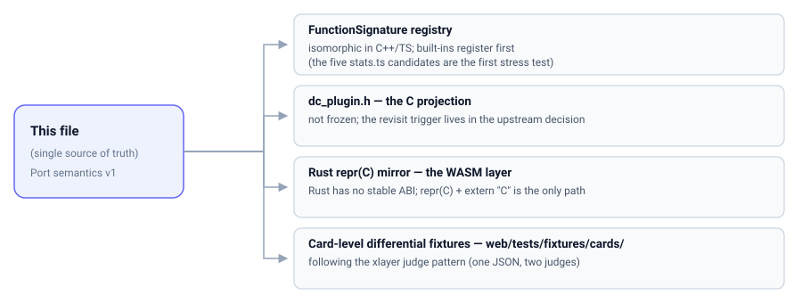

# Port semantics specification v1 (port-semantics-v1)

[中文](port-semantics-v1.md) | English

- **Date**: 2026-10-26
- **Status**: 🔒 semantics locked / **byte layout not frozen**
- **Role**: the **single source of truth** for function-card ports. The `FunctionSignature` registry
  (built-ins), the future `dc_plugin.h` (C projection), the Rust `repr(C)` mirror (WASM layer) and the
  card-level differential fixtures are all projections of this file; on conflict this file wins, and
  changing it requires a new decision record.
- **Upstream decision**: [card data structure v2](../decisions/2026-10-26-card-schema-v2.md)
- **Sibling document**: [backend protocol v1](backend-protocol-v1.md) (transport layer; this file is
  the function layer)

## Semantics overview (natural-language nested pseudo-JSON)

### Function signature FunctionSignature

```jsonc
{
  id: "stable identifier, e.g. builtin:svd / builtin:expression-columns. Never changes after release",
  version: "the signature's own revision. A semantic change must bump it; behaviour of the same id may not change silently",
  displayName: "human-facing name. Free to change, decoupled from id",

  inputs: [                       // N input-port declarations. N is fixed by the signature — the function's "socket shape"
    {
      portId: "stable identity. Renaming a display name ≠ changing portId; reordering ports ≠ changing portId. Connections only ever resolve by it, never by position",
      kind: "matrix | cell | scalar — the data shape this port accepts",
      required: "true|false. Semantics of an optional port with no connection = ABSENT (see evaluation.absence), not an empty matrix",
      dtype: "v1 has f64 (double) only. Adding a dtype value later = bump the signature version"
    }
  ],

  params: [                       // parameters are separated from data: scalars/configuration live here and never mix into inputs
    {
      name: "parameter name; stable-identity rules as for portId",
      type: "number | string | bool | enum",
      default: "default value. Parameters with a default can be collapsed in the UI",
      range: "numeric domain / enum choices",
      note: "params are part of the signature, not of the data-flow graph: changing a parameter creates or deletes no edge"
    }
  ],

  outputs: [                      // K output declarations. K is fixed by the signature, never decided by data
    {
      outputId: "stable identity, rules as for portId",
      kind: "matrix | table | scalar",
      note: "variable-length / variable-count results go into one table output; never 'how many rows you get is how many outputs you emit'. Heterogeneous multi-output (e.g. SVD's U/S/V) is expressed with several fixed outputIds"
    }
  ],

  errors: [                       // structured errors: reuse backend-protocol-v1 §structured errors
    { code: "e.g. shapeMismatch / singularMatrix", params: "placeholder parameters; the server never generates human prose" }
  ],

  traits: {
    deterministic: "same inputs + same params ⇒ same output. The premise of differential fixtures",
    cancellable: "whether cooperative cancellation is supported",
    progress: "whether progress is reported",
    compute: "auto | explicit — compute on creation, or only on POST /api/nodes/{id}/compute.
              Summary is the first explicit signature (conventions and state machine: decisions/2026-10-27-summary-builtin.md)",
    nanPolicy: "propagate | drop | error — every function must declare its NaN semantics (required by the max-headroom decision)"
  }
}
```

### Evaluation semantics evaluation (one capability, one entry point)

```jsonc
{
  inputSide: "metadata pushed, data pulled (vtable). The host first pushes n_inputs + a descriptor per port (kind/shape/ABSENT or not);
              the plugin calls host.pull(portId, row_range) as needed to obtain a read-only view (ptr, rows, cols, ld).
              The view is column-major and contiguous, element (i,j) = data[i + j*ld]; ld makes row windows / submatrices zero-copy and allows alignment padding.
              Bounds checks must use ld*cols; memcpy must not assume rows*cols*8",

  outputSide: "arena push. The plugin calls host.alloc(outputId, rows, cols) for a writable view and writes column-major.
               The arena is a chunked bump allocator: each output is contiguous internally, the arena as a whole need not be.
               After completion the host validates four things:
               ① size matches the declaration; ② all K outputs are filled (an unfilled one is a structured error, not undefined behaviour);
               ③ data + ld*cols stays inside the arena; ④ non-finite values are handled per the signature's nanPolicy",

  cancelProgress: "the cancellation hook and the progress hook hang on the same vtable, in the same entry structure as evaluation.
                  'Two interfaces with one capability' is permanently banned in this project: size may only be a loop count, never a branch condition —
                  the same card must take the same code path and give the same answer on small and large data",

  absence: "when an optional input is unconnected the descriptor has kind = ABSENT — explicit absence.
            An empty matrix (0×0) is legal data and ≠ absence; the NULL+0 sentinel encoding is forbidden"
}
```

### Ownership and boundaries ownership (invariants no language projection may violate)

```jsonc
{
  inputViews: "borrowed. The plugin must not free or write them (const semantics); the view never outlives the evaluation call",
  outputViews: "memory is allocated by the host arena; the plugin writes but does not own it; the host frees everything (who allocates, frees)",
  abiHygiene: "no STL / Eigen / Qt / std::string types in cross-boundary structs; the container layer has no layout contract —
               only (ptr, n) or a span, std::vector / QVector may not cross. Eigen appears only inside the plugin author's fence:
               Eigen::Map wraps the view, zero-copy. MatrixXd cannot alias external memory, so inputs may be borrowed while outputs must go through
               the arena — that asymmetry is the design root",
  layeredProjection: "L0 built-in functions (compile-time registration, native Eigen) → L1 WASM (sandboxed, interruptible,
                      capped by wasm32's 4 GB linear memory) → L2 out-of-process native (protocol v1, memfd shared memory, zero-copy).
                      All three implement the same FunctionSignature; this file is authoritative for semantics"
}
```

## Locked vs. open

**Locked** (changes require a new decision record):

1. portId / outputId are stable identities; addressing by position is forbidden;
2. K is fixed by the signature, never decided by data;
3. parameters are separated from data;
4. ABSENT is explicit absence, not an empty matrix;
5. cancellation / progress / evaluation share one entry point (no dual interfaces);
6. metadata pushed, data pulled; outputs via the arena; column-major + `ld`;
7. structured error code + params.

**Open** (blocking the freeze of the `dc_plugin.h` byte layout; must be decided before freezing):

- A. how ABSENT is encoded at the C boundary: an enum value for kind vs a separate presence bit field;
- B. how params cross the C boundary: a JSON string vs flattened POD fields vs host accessor functions.

## Projection map



This file is the only authority; the four layers below are **projections** of it, and where one disagrees, this file wins.
Interactive version (language/theme toggle, click to inspect): [`diagrams/interactive.html`](../diagrams/interactive.html).
