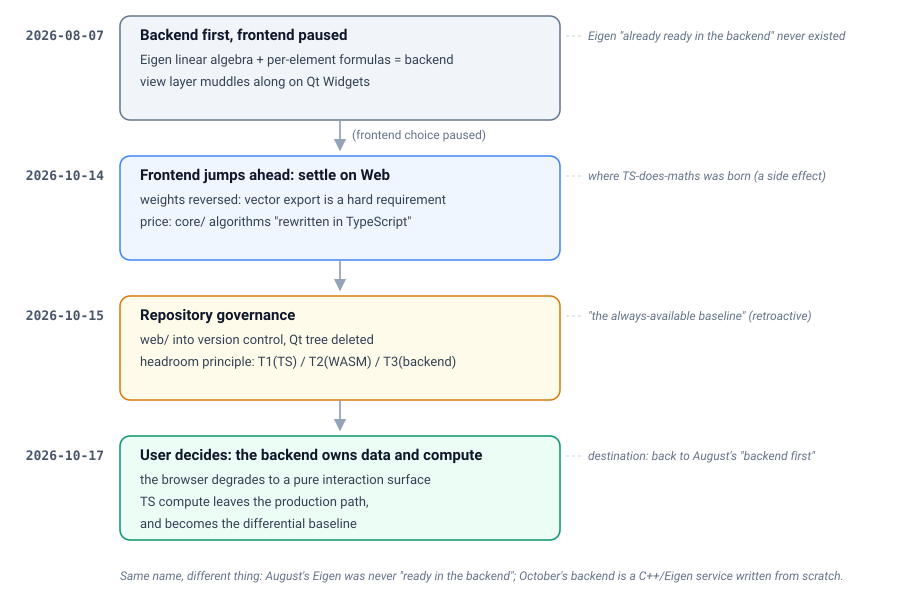

# Project history (DataCardForge)

[中文](history.md) | English

- **Compiled**: 2026-10-17
- **Nature**: a second pass. This document **creates no new decisions**; it only threads the fragments
  scattered across `decisions/`, `log/`, `lessons/` and `audits/` into one history along a **causal
  chain**. Every conclusion cites its source, and the source is authoritative.
- **Tags**: `#history #navigation #evolution #decision`

> How to read: for the quick version, see §1 and the flow diagram in §2; to understand "why we went the
> long way round", see the four spirals in §5 and the lessons in §6.

---

## 1. In one sentence

An industrial / scientific **data-matrix batch workbench** whose main direction was overturned four
times in 71 days:
**Qt/C++ frontend → freeze the frontend, do the backend first → pure Web/TS → the backend owns compute
again**.
None of those reversals added a feature; each was a **deeper understanding of the same core demand:
there must be no wall in the worst case**.

---

## 2. Decision flow

> Interactive version (click a stage for its reasoning and sources; language/theme toggle):
> [`diagrams/interactive.html`](diagrams/interactive.html). Conventions: [navigation](README.en.md#diagrams).

**The irony is visible at a glance**: the destination (backend computes) and the starting point
(backend first) share a name, but this backend is not that backend — August's Eigen "already ready in
the backend" **never existed** (§3.1), and October's backend is a **C++/Eigen service written from
scratch**.

---

## 3. Timeline (by date, with sources)

| Date | Event | Type | Source |
|---|---|---|---|
| 2026-08-07 | "Backend first, frontend paused" published: Eigen + per-element formulas go to the C++ backend; the frontend choice is paused | decision | [decisions/2026-08-07-backend-first-frontend-paused](decisions/2026-08-07-backend-first-frontend-paused.md) |
| 2026-08-07 | "Connection subordination principle" established: connections live in the background layer and never constrain card layout | decision | [decisions/2026-08-07-connection-subordination](decisions/2026-08-07-connection-subordination.md) |
| 2026-08-07 | `imguitest/` ImGui+ImPlot demo finished (connections / table / line chart all working) | implementation | [log/2026-08-07](log/2026-08-07.md) |
| 2026-08-07 | Two lessons recorded: the ImPlot v1.1 API overhaul, the ImGui Docking PushStyleColor crash | lesson | [lessons/implot-v1.1-api](lessons/implot-v1.1-api.md) · [lessons/imgui-docking-pushstylecolor](lessons/imgui-docking-pushstylecolor.md) |
| 2026-10-14 | Frontend choice restarted, **settled on Web** (React 19 + Vite 8 + TS 7 + ECharts 6 SVG + zustand) | decision | [decisions/2026-10-14-frontend-web-chosen](decisions/2026-10-14-frontend-web-chosen.md) |
| 2026-10-14 | `web/` implemented in full: each algorithm ported to TS along the C++ module boundaries (core/loaders/ui) | implementation | [log/2026-10-14](log/2026-10-14.md) |
| 2026-10-14 | Chart-library audit: **keep ECharts**, fill in error bars / violin via a `custom` series | decision | [decisions/2026-10-14-chart-library-audit](decisions/2026-10-14-chart-library-audit.md) |
| 2026-10-14 | Nine statistical chart types + the SVG/PNG/PDF export pipeline delivered | implementation | same as above |
| 2026-10-14 | Five porting defects fixed (including "switch file → charts follow", which never actually worked in the Qt version) | fix | [log/2026-10-14](log/2026-10-14.md) |
| 2026-10-15 | **Repository governance**: `web/` into version control → then remove the Qt/C++ tree (215 MB) | decision | [decisions/2026-10-15-qt-implementation-removed](decisions/2026-10-15-qt-implementation-removed.md) |
| 2026-10-15 | CRLF pollution cleaned up: workspace diff dropped from 23 775 lines to 231 | governance | [log/2026-10-15](log/2026-10-15.md) |
| 2026-10-15 | Defect family A/B/D/E/F fixed (dead anchors, same-name file reusing old data, cycle detection…) | fix | same as above |
| 2026-10-15 | **Headroom principle** established: three tiers T1/T2/T3 + three contracts | decision | [decisions/2026-10-15-max-headroom-principle](decisions/2026-10-15-max-headroom-principle.md) |
| 2026-10-15 | Adversarial UI/chart review: 34 defects + 11 in a second pass | audit | [audits/2026-10-15-ui-chart-defect-audit](audits/2026-10-15-ui-chart-defect-audit.md) |
| 2026-10-16 | v1.0.0 released, establishing the rollback baseline (tag `v1.0.0`, commit `d077fce`) | release | commit `d077fce` |
| 2026-10-17 | **Backend-owned compute decided**: the backend holds data and compute, the browser degrades to a pure interaction surface | decision | [decisions/2026-10-17-backend-owns-compute](decisions/2026-10-17-backend-owns-compute.md) |
| 2026-10-17 | Backend protocol v1 draft (transport / resources / endpoints / binary frame / errors / differential fixtures) | architecture | [architecture/backend-protocol-v1](architecture/backend-protocol-v1.md) |
| 2026-10-17 | Toolchain verified: g++ 15.2 / cmake 4.2 / ninja 1.13 / Eigen 3.4 **already installed** | environment | [decisions/2026-10-17-backend-owns-compute](decisions/2026-10-17-backend-owns-compute.md) |
| 2026-10-21 | Stage 3: formula-card compute authority moves to the backend · differential fuzz gate · canvas becomes an unbounded plane | decision/implementation | [decisions/2026-10-21-infinite-canvas](decisions/2026-10-21-infinite-canvas.md) · [log/2026-10-21](log/2026-10-21.md) |
| 2026-10-26 | Card data structure v2: dependencies promoted to the envelope, function card = one node with K outputs | decision | [decisions/2026-10-26-card-schema-v2](decisions/2026-10-26-card-schema-v2.md) |
| 2026-10-27 | The three contracts of a function card: column count · parameter ownership · single-column ports | decision | [decisions/2026-10-27-card-contracts](decisions/2026-10-27-card-contracts.md) |
| 2026-10-27 | Summary (`builtin:summary`) v1: statistic catalogue, lazy evaluation, numbers stay in the backend | decision | [decisions/2026-10-27-summary-builtin](decisions/2026-10-27-summary-builtin.md) |
| 2026-10-28 | Port-level connections: dependency edges carry portId, endpoints land on ports, direction arrows | fix | [decisions/2026-10-28-port-level-connections](decisions/2026-10-28-port-level-connections.md) · [log/2026-10-28](log/2026-10-28.md) |
| 2026-10-28 | **Expression column-reference syntax**: `Pos.N` / annotation name / `[column name]` / port qualification + full-width punctuation; formula cards work again on files with headers | decision | [decisions/2026-10-28-expression-reference-syntax](decisions/2026-10-28-expression-reference-syntax.md) |
| 2026-10-28 | Empty-state "Open data files" button restored: the canvas `setPointerCapture` swallowed the click | fix | [log/2026-10-28](log/2026-10-28.md) |
| 2026-10-28 | Formula-card help entry points (Help menu + `?` + a 1 s hover tooltip at the pointer + clickable column chips) | implementation | [log/2026-10-28](log/2026-10-28.md) |
| 2026-10-28 | Three real defects in function-card output binding: local id / upload race / the entry points vanishing with an empty result table | decision | [decisions/2026-10-28-function-card-output-binding](decisions/2026-10-28-function-card-output-binding.md) |
| 2026-10-29 | Result preview and dense frames: the **DCM2** header is 24 bytes and carries the full table shape | decision | [decisions/2026-10-29-result-preview](decisions/2026-10-29-result-preview.md) |
| 2026-10-29 | Connection anchors move to port centres (no longer the midpoint of a card edge) | decision | [decisions/2026-10-29-connection-center-anchors](decisions/2026-10-29-connection-center-anchors.md) |
| 2026-10-29 | Engine-level performance gate: 12 cases, p50×3 budget, 1.3× regression guard | decision | [decisions/2026-10-29-perf-gate](decisions/2026-10-29-perf-gate.md) |
| 2026-10-31 | Regression card renamed "relation enumeration": picking a column becomes a port binding, headers carry `X : Y` | decision | [decisions/2026-10-31-relation-enum-card](decisions/2026-10-31-relation-enum-card.md) |
| 2026-10-31 | Data cards can replace their file: replacing follows automatically, switching still re-points explicitly | decision | [decisions/2026-10-31-file-replacement](decisions/2026-10-31-file-replacement.md) |
| 2026-11-03 | Repository made public; `main` advanced ~20 commits through PRs #1–#4, author names rewritten (ids unchanged) | governance | `STATE.md` |
| 2026-11-03 | 0.1.1 / 0.1.2: release archive becomes "binary + `web/`", the backend serves the UI itself; Windows build goes fully static | release | [CHANGELOG](../CHANGELOG.md) |
| 2026-11-04 | 0.1.3 (untagged): the double-click launch chain — console subsystem assertion + `AllocConsole` + `ShellExecuteW` | release | [CHANGELOG](../CHANGELOG.md) · `STATE.md` |
| 2026-11-04 | Precision audit: `dd_oracle` (double-double reference) + `matrix_invariants`; the table switches to shortest round-trip; `/accuracy` endpoint added | audit | `STATE.md` · [CHANGELOG](../CHANGELOG.md) |

---

## 4. Four eras (each is a "cross the line → correct it" structure)

### 4.1 Era one · Qt/C++ monolith (≤ 2026-08-07)

**Shape**: a C++/Qt Widgets desktop app, `core/` as the data layer, `widgets/` as the UI.
**What we believed**: what the backend can compute decides what the frontend can show → build the
backend (Eigen linear algebra, per-element formulas) solidly first.

**The trap it laid (the most expensive one)**:
> the README listed **Eigen as "Next priority"**, but `third_party/eigen` was only a **bare gitlink with
> no `.gitmodules`**, so a clone necessarily yields an empty directory; `CMakeLists.txt` and `src/` had
> **zero Eigen references**.
> That is, "Eigen is already ready in the backend" **never held**.

**Why it went unnoticed**: it did not affect compilation (nothing linked it), only **judgement** — the
whole of August's prioritisation rested on an asset that did not exist.

### 4.2 Era two · frontend frozen (2026-08-07 → 10-14)

**Decision**: pause the frontend choice (ImGui / Web); muddle along with Qt for the view layer.
**Reason**: avoid investing twice in "technology that might be replaced later".

**A premise later judged wrong** (written in that decision's postscript):
> "vector export is a **possible** requirement" — it was in fact the **end-goal requirement**.
> Lesson: **distinguish "what the user ultimately delivers" from "what the intermediate process
> needs"; the former cannot be deferred.**

### 4.3 Era three · pure Web / TypeScript (2026-10-14 → 10-17)

**Decision**: frontend settled on Web, main implementation in `web/`, **algorithms rewritten in TS**.
**Weights re-estimated**: vector export free (ECharts SVG native, ImPlot has none), Chinese IME free,
the whole "embed ImGui in a WebView" complexity gone (the browser is the host). The performance worry
was disproved by measurement (10 000 rows need only 23 DOM row nodes).

**This is the project's most consequential side effect**:
> "do the maths in TS" **was never proposed on its own**. It hid in the **"price"** section of the
> 10-14 decision — "the algorithms in `core/` are rewritten in TypeScript under `web/src/core/`, with
> semantic alignment enforced by tests rather than a shared binary". The same day's log left the door
> open: *"the Web side must evaluate WASM versus a TS implementation"*.

**A day later it was retroactively named "the baseline"**: on 10-15 the headroom principle set T1 as
in-browser TS, cast as "the always-available fallback tier". But the principle document itself exposed
the earlier mistake:
> the earlier argument had been framed as a **performance crossover point** ("if TS is fast enough, skip
> the backend"); once the user re-anchored the core demand, that whole framing was void — the backend
> exists not to be "faster" but to **remove the ceiling** (algorithm coverage, memory limits, worst-case
> compute).

### 4.4 Era four · backend owns compute (2026-10-17 → )

**Decision (made by the user)**: all numeric / statistical / matrix computation belongs to the server;
the browser only renders and interacts.
The half of that sentence which outlived the conclusion — **parsing and compiling a formula counts as
computation too**, and it does not move back to the frontend either:
> "If dynamic needs really appear, send the formula to the backend to parse or even compile — but do
> not compute in the frontend."

**What triggered it was a measurement** (the function-card design review exposed the layering hole):

| Payload | JSON | encode+decode | one round trip | same maths in local JS |
|---|---|---|---|---|
| scalar | 22 B | 0.003 ms | **1.27 ms** | — |
| 10×10 | 1.9 KB | 0.039 ms | **1.11 ms** | 0.0099 ms |
| 100×100 | 193 KB | 3.19 ms | **2.32 ms** | 4.68 ms |

> For small matrices the crossing cost ≈ **fixed latency × number of crossings**, independent of byte
> count.
> A 10-node small-matrix chain crossing the process boundary per edge ≈ 8.3 ms; the whole chain in one
> process ≈ 0.075 ms (**≈ 110×**).
> Conclusion: **a mixed layering (this card on T1, that one on T3) necessarily degrades to paying per
> edge in small-matrix workflows** → only "the whole graph stays on one side" works, and of the two
> extremes we chose **the whole graph in the backend**.

**Revision of the previous generation of decisions**: T1 is no longer the baseline and leaves the
production compute path; `expression.ts` / `stats.ts` / `Smoothing.ts` are **frozen as the differential
reference baseline and retired step by step**.

---

## 5. Four "spirals" (the same question met again and again)

The value of history is not in dates but in **which questions keep coming back**. Each of these four
went round at least twice:

### Spiral one · where compute lives: frontend → backend → frontend (TS) → backend

Each migration swapped the set of arguments: **insufficient capability** (Aug) → **user requirement
weight** (10-14) → **worst-case fallback** (10-15) → **round-trip economics** (10-17).
What finally stabilised is not "where it lives" but the criterion itself: **"will the operator hit a
wall?"**

### Spiral two · what guarantees semantic parity

`shared binary` (C++ used directly) → `tests and assertions` (TS rewrite, 154 cases) → **cross-tier
shared fixtures + differential testing** (TS and C++ run the same JSON fixtures).
The third form is the strictest, and it was required to **land before the engine** (fixtures first).
On 2026-10-27 this spiral reached the **card layer**: `web/tests/fixtures/cards/*.json` runs on both
sides — TS (port-binding derivation and fixture self-consistency) and C++ (the matrices and structured
errors produced by the real `NodeRegistry`). Before that, the card→port mapping had **three mutually
different definitions** (frontend model / frontend DTO / backend PortBinding) and nothing could point
out that they disagreed.
> Sources: [backend-protocol-v1 §differential-testing contract](architecture/backend-protocol-v1.md),
> [card schema v2 §implementation results](decisions/2026-10-26-card-schema-v2.md)

### Spiral three · repository shape: one implementation vs two

The C++/Qt tree was kept as a "behavioural reference" → we found it **cost 215 MB and left the main
implementation `web/` outside version control** → deleted entirely.
> The method distilled from it: **first bring what stays under version control, then delete what goes** —
> nominally irreversible, actually reversible.

### Spiral four · how we verify: assertions → real artefacts → pixels/geometry

`smoke.mjs` grew from 31 → 58 → 61 checks, yet at 61 green it still had defects like "the context menu
opens outside the viewport" that made a core feature completely unusable — because the tests clicked by
selector and never verified **position, reachability or visual correctness**.
> Lesson: **an end-to-end test passing ≠ the UI works**; assertion counts cannot validate visualisation
> either — **you must actually look at the picture** (hence fixed screenshot artefacts).
>
> On 2026-10-27 another variant of the same family was caught: a function card fetched only one
> `count=5000` result window, so a 10 000-row source table showed only its first half inside the card —
> **every number correct, the picture lying**. No differential fixture (which judges "is the maths
> right") could catch it, because it was not a computation error but **incomplete transport**. The
> countermeasure was to add an integration gate against the real backend.

---

## 6. Lesson list (usable directly as a review checklist)

### 6.1 About "do not trust assets the docs claim"

1. **"Already ready" only counts if it compiles and runs.** The Eigen gitlink lesson: a submodule
   without `.gitmodules` = an empty directory.
   Re-checked during this pass (2026-10-17): in the backup repository `repo.git`, the only path
   containing eigen is the single gitlink `third_party/eigen`, and neither `CMakeLists.txt` nor `src/`
   references it — **the false premise is confirmed**.
2. **"I can reproduce it" ≠ "someone else can reproduce it"**; private hacks must be turned into
   in-repo scripts to count as a regression defence.
3. **"The docs say so" ≠ "the code has it"**: `setEditable` / `setCell()` were claimed in the README
   while nothing in the repository ever called them.

### 6.2 About verification

4. **Test order hides bugs** (scroll first, then build the chart — precisely masking dead anchors).
5. **Self-tests passing ≠ the graphic is right** (the violin plot was wrong twice).
6. **Compiling ≠ being checked** (`Extract<SeriesOption, {type:'custom'}>` silently degraded to `any`).
7. **When you remove a masking bug, verify the dependency array at the same time** ("recompute on every
   render" was also the fig leaf of another bug).

### 6.3 About silent failure (what the headroom principle names explicitly)

8. The parse cache was keyed by **file name** → today's curve wearing yesterday's label.
9. The heatmap drew "undefined correlation" as `0` → the meaning changed from "cannot be defined" to
   "uncorrelated" (**actively misleading**).
10. `&&` appeared in the precedence table but the lexer never produced it → multi-condition filtering
    silently unusable.
11. Workspace snapshots rebuilt dependencies only from chart cards → formula-card dependencies were
    **silently lost** after reload.
12. An explicit X axis was a frozen snapshot → after switching files the curve was drawn against the
    old file's independent variable.

> When reviewing any new path, ask three questions:
> **Under what conditions does it fail? When it fails, can the operator see it? What does it show while
> degraded?**

### 6.4 About the decision process

13. **Distinguish "end-goal requirements" from "intermediate-process requirements"** — vector export was
    misjudged as "possible", and the price was eight weeks of a frozen frontend.
14. **Resolve philosophical conflicts by asking about the worst case, not by finding a performance
    crossover point**.
15. **Decision authority is concentrated**: every commit's author is `DozenLow`, key decision documents
    are marked "decided by the user", and the split is described in the
    [README acknowledgements](../README.zh-CN.md#致谢) — **AI as the means, goals/architecture decided
    by the author**.

---

## 7. State of play (2026-10-17 snapshot)

> **This is a snapshot, not the current state.** The judgements of 2026-10-17 are kept as they were (history is not rewritten); **the current state** lives in §7.4 and in the repository-root `STATE.md`, which is the only authority on "where we are now".

### 7.1 Established

| Dimension | Current state | Source |
|---|---|---|
| Frontend | Web, `web/` (React 19 / TS 7 / Vite 8 / ECharts 6 @ SVG) | 10-14 decision |
| Backend | **new `backend/`**: C++/CMake service, matrix store + dependency graph + Eigen operators + scheduler | 10-17 decision |
| Compute ownership | **all on the server**; the frontend only renders and lays out (axes / virtual-scroll window fetch / SVG-to-bitmap export) | 10-17 decision |
| Transport | HTTP/1.1 local service (default `127.0.0.1:37811`), JSON control + binary frames (magic `DCM1` at the time; since 10-29 the server only emits `DCM2`, see §7.4) + long-poll events | protocol v1 |
| Environment | g++ 15.2.0 / cmake 4.2.3 / ninja 1.13.2 / **Eigen 3.4.0 preinstalled** (smoke compile passed) | 10-17 decision |
| Error contract | the server sends only `code + params`, **never user-facing sentences**; copy is rendered by frontend i18n | protocol v1 |
| Rollback baseline | tag `v1.0.0` (`d077fce`) | commit |

### 7.2 To do (from the 10-17 decision)

- **Stage 0**: cross-tier shared fixtures first (`web/tests/fixtures/xlayer/`)
- **Stage 1**: `backend/` skeleton + protocol handshake + Matrix/Node endpoints
- **Then**: port `expression.ts` semantics to C++ (including the `code + params` error table), Eigen
  operators, turn `workspaceStore` from "holds matrices" into "commands + subscribing client", a
  windowed data source for `VirtualTable`
- `stats.ts` / `Smoothing.ts` move after function cards; **since 10-17 the frontend adds no new numeric
  computation**

### 7.3 Known gaps (stated, not silent)

- Backend unreachable ⇒ no compute at all (**single-point dependency**; countermeasures: explicit
  banner + retry + liveness probe on page load)
- Local fixed latency ≈ 1.1 ms per round trip
- Large results cannot be downloaded whole (10⁷ rows cannot travel as JSON) ⇒ windowing + binary frames
- No authentication; a token must be added before cross-machine deployment
- PDF is a **bitmap wrapper** and **EPS is not offered** (the browser has no PostScript generation path;
  a platform constraint)

### 7.4 Current state, as of 2026-11-04

| Dimension | Current state | Source |
|---|---|---|
| Version | 0.1.3 (untagged); the release archive is "binary + `web/`" in three asset tiers (standard / perf / debug) | [CHANGELOG](../CHANGELOG.md) |
| Backend | C++17/Eigen service on `127.0.0.1:37811`, serving the `web/` UI from the same process; the `build` field of `/api/hello` must equal the current HEAD | `STATE.md` |
| Transport | Protocol v1: JSON control plane + **DCM2** frames (24-byte header, carries the full table shape) + long-poll events; `DCM1` is only accepted as legacy input | [protocol v1](architecture/backend-protocol-v1.en.md) |
| Frontend | React 19 / Vite / TS / ECharts 6 (SVG rendering); a Web Worker parses ten-thousand-row files; interaction only, no numeric computation | [README.md](../README.md) |
| Tests | vitest **594 passed / 14 skipped** (measured locally on 2026-11-04); ctest **14/14** (4 opt-in skipped) | `npx vitest run` · `ctest` · `STATE.md` |
| Precision | `dd_oracle` reference + `matrix_invariants` invariants; the table prints the shortest round-trip form (no longer capped at six digits); `POST /api/nodes/{id}/accuracy` is ready, **the front-end hint is not** | `STATE.md` · [CHANGELOG](../CHANGELOG.md) |
| Known gaps | function-card parameter form not rendered from the signature / no K>1 output selector; `web/src/core/stats.ts` still computes statistics; the perf gate only covers the engine; no undo stack; the Windows double-click was never re-tested on real hardware | `STATE.md` |

> Maintenance rule: this table holds **pointers only, never detail** — the detail lives in `STATE.md` and
> the decision records. When `STATE.md` moves, only the "as of" date and the named conclusions change here.

---

## 8. Documentation inconsistencies found during this pass (suggested fixes)

> These are "document vs document" contradictions found while reading 20 documents. They **do not
> affect the code**, but they mislead the next reader.
> **Re-check (2026-10-21)**: every row was re-verified against the current repository and a "status"
> column added — #1/#4 were fixed by later commits; #2/#3 mostly fixed; #5/#6 fixed that day. One new
> finding was also recorded: **the README claimed cell edits were persisted to the backend, while that
> forwarding existed only in an uncommitted working-tree diff** (exactly §6.1-3 "『the docs say so』≠
> 『the code has it』" repeating — a feature claim should carry a code reference and be reviewed
> together with the commit).

| # | Problem | Location | Suggestion | Status (re-checked 2026-10-21) |
|---|---|---|---|---|
| 1 | **Dead link**: navigation points at `log/2026-10-17`, but that log file **does not exist** | [docs/README](../README.md#L23) | write the log, or drop the navigation entry | ✅ fixed (the log file now exists) |
| 2 | **The main README had not followed the 10-17 decision**: it still said "layering (TS → WASM → backend) is the automatic upgrade path" and "the compute fallback tier… must be built" | [README.zh-CN L14](../README.zh-CN.md#L14) · [L133](../README.zh-CN.md#L133) · [L141](../README.zh-CN.md#L141) | rewrite per the 10-17 decision as "backend = baseline" | ✅ mostly fixed (the design-philosophy section now says backend-owned compute; the residual risk became "docs ahead of code", see the new finding above) |
| 3 | **The README's "current priorities" were stale**: it said "per-element formulas + headroom principle", while the real priority was "backend-owned compute + stage-0 fixtures" | [README.zh-CN L131](../README.zh-CN.md#L131) | sync with the 10-17 decision | ✅ fixed (now a "short-term goals" checklist with ticks as commits land) |
| 4 | **The chart-library decision was missing from navigation** | [docs/README](../README.md) | navigation never registered `2026-10-14-chart-library-audit` | ✅ fixed (registered) |
| 5 | **The `architecture/` description was stale**: it called it "comparisons not yet decided, still to be argued", but `backend-protocol-v1` was already a v1 draft spec | [docs/README L16](../README.md#L16) | split into "specifications" and "trade-offs" | ✅ fixed (2026-10-21: navigation split into 📐 specs / ⚖️ trade-offs; the protocol status line went from "draft" to "v1 specification") |
| 6 | **Acknowledgement attribution to re-check**: the README said the project is developed with the aid of **GitHub Copilot**, yet the nine commits carried **no agent trailer** and author strings included `DataCardForge Dev <dev@datacardforge.local>` / `DataCardForge audit <agent@local>` | [README.zh-CN L164](../README.zh-CN.md#L164) · [README L167](../README.md#L167) | update the attribution to the tools actually used | ✅ fixed (2026-10-21: both READMEs now say "AI coding agents (DeepSeek Harness / Claude-class tooling, and earlier GitHub Copilot)") |

| 7 | **Three decision records missing from navigation**: `2026-10-28-function-card-output-binding`, `2026-10-29-connection-center-anchors`, `2026-10-29-result-preview` were never registered | [docs/README](README.en.md) | register them | ✅ fixed (2026-11-04: navigation rewritten) |
| 8 | **`audits/` and `sampleData/` were not in the navigation at all**: present in the vault, invisible in the index | [docs/README](README.en.md) | add a section for each | ✅ fixed (2026-11-04) |
| 9 | **§7 reads like "current state"**: the heading says 2026-10-17, yet the body talks about to-dos and known gaps | `history.md` §7 | mark it as a snapshot and move the current state to §7.4 | ✅ fixed (2026-11-04) |
| 10 | **Conflicting authority**: docs/README says "the authoritative document is the root README", `AGENTS.md` says "`STATE.md` is the current truth" | [docs/README](README.en.md) · `AGENTS.md` | split into three entrances: what / where are we now / why | ✅ fixed (2026-11-04) |
| 11 | **A private directory inside a public vault**: `docs/private/` is gitignored but still sits in the vault, contradicting "publishable content only" | `.gitignore` · `docs/README` | state in the README that it is local-private and out of scope for publication | ✅ documented (2026-11-04) |
| 12 | **Character-drawn diagrams**: the decision flow, the projection tree and the root README architecture block — 6 places; one changed glyph width breaks the alignment, and they are unreadable on a phone | `history.md` §2 · `architecture/port-semantics-v1.md` · `README*.md` | replace with SVG (Chinese/English pairs) | ✅ fixed (2026-11-04: see [`diagrams/`](diagrams/)) |
| 13 | **Stale test numbers**: §7.1 said 507 passed / ctest 8, the Chinese README said 581 / 9, now 594 / 14 | `history.md` §7.1 | §7.4 carries the current numbers, §7 keeps the snapshot | ✅ fixed (2026-11-04) |

> **Added 2026-11-04**: the §3 timeline used to stop at 2026-10-28 and was missing 10-21, 10-26, 10-27,
> 10-29, 10-31 and the November releases/audit. It is now backfilled from each decision file's header; the
> two November entries have no `log/` file, so their sources are `CHANGELOG.md` and `STATE.md`.
> Note that `log/` still stops at 2026-10-31 — there are no log files for 11-03 or 11-04.

---

## 9. Related

- Navigation: [vault navigation](README.en.md)
- Where we are now (authoritative): the repository-root `STATE.md` — when docs and code disagree, it wins
- Core principle: [headroom principle](decisions/2026-10-15-max-headroom-principle.md)
- Current ruling: [the backend owns data and compute](decisions/2026-10-17-backend-owns-compute.md)
- Protocol: [backend protocol v1](architecture/backend-protocol-v1.en.md)
- Authoritative document ("what"): repository root [`README.zh-CN.md`](../README.zh-CN.md); this vault
  records "why"
