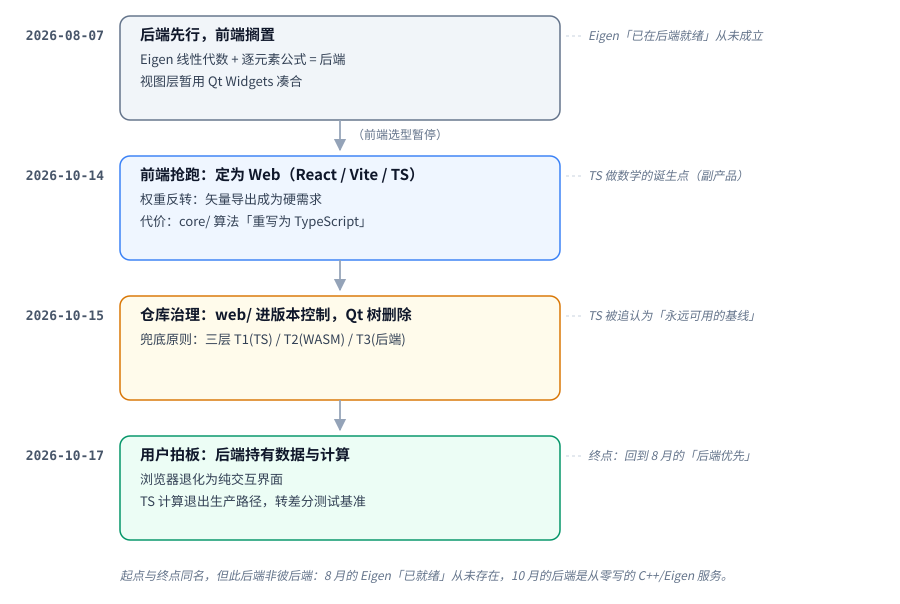

# 项目演进史（DataCardForge）

中文 | [English](history.en.md)

- **性质**：把决策、日志、踩坑、审计按因果链串成一条历史。本文不产生新决策，每条结论都带出处，出处才是权威。
- **截至**：2026-11-04。本文解释"为什么走到这里"；"现在在哪"以仓库根 `STATE.md` 为准。
- **标签**：`#历史 #导航 #演进 #决策`

> 阅读方式：§1 + §2 是概要；四次方向推翻的原因与代价见 §4，反复出现的问题见 §5，可复用的检查项见 §6。

---

## 1. 一句话

一个工业/科研向的数据矩阵批处理工作台，在 71 天里被推翻了四次主要方向：
**Qt/C++ 前端 → 冻结前端先做后端 → 纯 Web/TS → 后端重新持有计算**。
每一次推翻都不是加新功能，而是对同一条核心诉求——最坏情况没有墙——的理解变深了一层。

---

## 2. 决策流向图

> 交互版（点选阶段看当时的判断与出处、切中英/主题）：[`diagrams/interactive.html`](diagrams/interactive.html)
> 生成方式与约定见 [导航](README.md#图diagrams)。

---

## 3. 时间线（按日期，含出处）

| 日期 | 事件 | 类型 | 出处 |
|---|---|---|---|
| 2026-08-07 | 「后端先行，前端搁置」出炉：Eigen + 逐元素公式排在 C++ 后端；前端选型暂停 | 决策 | [decisions/2026-08-07-backend-first-frontend-paused](decisions/2026-08-07-backend-first-frontend-paused.md) |
| 2026-08-07 | 「连线从属原则」确立：连线住背景层，不约束卡片布局 | 决策 | [decisions/2026-08-07-connection-subordination](decisions/2026-08-07-connection-subordination.md) |
| 2026-08-07 | `imguitest/` ImGui+ImPlot Demo 完成（连线/表格/折线全部跑通） | 实现 | [log/2026-08-07](log/2026-08-07.md) |
| 2026-08-07 | 两条踩坑沉淀：ImPlot v1.1 API 大改、ImGui Docking 的 PushStyleColor 崩溃 | 教训 | [lessons/implot-v1.1-api](lessons/implot-v1.1-api.md) · [lessons/imgui-docking-pushstylecolor](lessons/imgui-docking-pushstylecolor.md) |
| 2026-10-14 | 前端选型重启，定为 Web（React 19 + Vite 8 + TS 7 + ECharts 6 SVG + zustand） | 决策 | [decisions/2026-10-14-frontend-web-chosen](decisions/2026-10-14-frontend-web-chosen.md) |
| 2026-10-14 | `web/` 全量落地：按 C++ 模块边界逐算法移植为 TS（core/loaders/ui） | 实现 | [log/2026-10-14](log/2026-10-14.md) |
| 2026-10-14 | 图表库审计：保持 ECharts，用 `custom` series 补齐误差棒/小提琴 | 决策 | [decisions/2026-10-14-chart-library-audit](decisions/2026-10-14-chart-library-audit.md) |
| 2026-10-14 | 9 种统计图型 + SVG/PNG/PDF 导出管线交付 | 实现 | 同上 |
| 2026-10-14 | 修复 5 处移植缺陷（含"切文件→图表联动"在 Qt 版从未生效） | 修复 | [log/2026-10-14](log/2026-10-14.md) |
| 2026-10-15 | 仓库治理：`web/` 进版本控制 → 再移除 Qt/C++ 树（215 MB） | 决策 | [decisions/2026-10-15-qt-implementation-removed](decisions/2026-10-15-qt-implementation-removed.md) |
| 2026-10-15 | CRLF 污染清理：工作区 diff 从 23775 行降到 231 行 | 治理 | [log/2026-10-15](log/2026-10-15.md) |
| 2026-10-15 | 修复缺陷族 A/B/D/E/F（A/B/D/E/F 为审计编号的缺陷分组；锚点失效、同名文件复用旧数据、环检测…） | 修复 | 同上 |
| 2026-10-15 | 兜底原则确立：三层 T1/T2/T3（按决策文档：T1 浏览器 JS / T2 WASM SIMD worker / T3 原生后端）+ 三个契约 | 决策 | [decisions/2026-10-15-max-headroom-principle](decisions/2026-10-15-max-headroom-principle.md) |
| 2026-10-15 | 对抗式 UI/图表审查：34 项缺陷 + 第二轮复验 11 项 | 审计 | [audits/2026-10-15-ui-chart-defect-audit](audits/2026-10-15-ui-chart-defect-audit.md) |
| 2026-10-16 | v1.0.0 发布，确立回滚基线（tag `v1.0.0`，提交 `d077fce`） | 发布 | commit `d077fce` |
| 2026-10-17 | 后端持有计算拍板：后端持有数据与计算，浏览器退化为纯交互界面 | 决策 | [decisions/2026-10-17-backend-owns-compute](decisions/2026-10-17-backend-owns-compute.md) |
| 2026-10-17 | 后端协议 v1 草案（传输/资源/端点/二进制帧/错误/差分夹具） | 架构 | [architecture/backend-protocol-v1](architecture/backend-protocol-v1.md) |
| 2026-10-17 | 工具链核实：g++ 15.2 / cmake 4.2 / ninja 1.13 / Eigen 3.4 已预装 | 环境 | [decisions/2026-10-17-backend-owns-compute](decisions/2026-10-17-backend-owns-compute.md) |
| 2026-10-21 | 阶段 3：公式卡计算权威切到后端 · 差分 fuzz 门禁 · 画布改为无边界平面 | 决策/实现 | [decisions/2026-10-21-infinite-canvas](decisions/2026-10-21-infinite-canvas.md) · [log/2026-10-21](log/2026-10-21.md) |
| 2026-10-26 | 卡片数据结构 v2：依赖升到信封、函数卡 = 单节点 K 输出 | 决策 | [decisions/2026-10-26-card-schema-v2](decisions/2026-10-26-card-schema-v2.md) |
| 2026-10-27 | 函数卡的三个契约：列数 · 参数归属 · 单列端口 | 决策 | [decisions/2026-10-27-card-contracts](decisions/2026-10-27-card-contracts.md) |
| 2026-10-27 | 摘要（`builtin:summary`）v1：统计量目录、惰性求值、数字归后端 | 决策 | [decisions/2026-10-27-summary-builtin](decisions/2026-10-27-summary-builtin.md) |
| 2026-10-28 | 端口级连线：依赖边携带 portId、端点落端口、方向箭头 | 修复 | [decisions/2026-10-28-port-level-connections](decisions/2026-10-28-port-level-connections.md) · [log/2026-10-28](log/2026-10-28.md) |
| 2026-10-28 | 表达式列引用语法：`Pos.N`/注解名/`[列名]`/端口限定 + 全角标点；公式卡对带表头文件恢复可用 | 决策 | [decisions/2026-10-28-expression-reference-syntax](decisions/2026-10-28-expression-reference-syntax.md) |
| 2026-10-28 | 空状态「打开数据文件」按钮恢复：画布 `setPointerCapture` 吞掉了 click | 修复 | [log/2026-10-28](log/2026-10-28.md) |
| 2026-10-28 | 公式卡帮助入口（帮助菜单 + `?` + 悬停 1 s 位置提示 + 可点列芯片） | 实现 | [log/2026-10-28](log/2026-10-28.md) |
| 2026-10-28 | 函数卡输出绑定的三处真缺陷：本地 id / 上传竞态 / 结果表为空的连带入口消失 | 决策 | [decisions/2026-10-28-function-card-output-binding](decisions/2026-10-28-function-card-output-binding.md) |
| 2026-10-29 | 结果预览与稠密帧：DCM2（二进制数据帧格式）帧头 24 字节、携带整表形状 | 决策 | [decisions/2026-10-29-result-preview](decisions/2026-10-29-result-preview.md) |
| 2026-10-29 | 连线锚点改落端口中心（不再从卡片边中点出入） | 决策 | [decisions/2026-10-29-connection-center-anchors](decisions/2026-10-29-connection-center-anchors.md) |
| 2026-10-29 | 引擎层性能门禁：12 个用例、p50×3 预算、1.3× 回归护栏 | 决策 | [decisions/2026-10-29-perf-gate](decisions/2026-10-29-perf-gate.md) |
| 2026-10-31 | 回归卡改名「关系枚举」：选列变成端口绑定、列头带 `X : Y` | 决策 | [decisions/2026-10-31-relation-enum-card](decisions/2026-10-31-relation-enum-card.md) |
| 2026-10-31 | 数据卡可以换文件：换数据自动跟随，切文件仍显式重指向 | 决策 | [decisions/2026-10-31-file-replacement](decisions/2026-10-31-file-replacement.md) |
| 2026-11-03 | 仓库公开；`main` 经 PR #1–#4 推进约 20 提交，作者名统一改写（id 不变） | 治理 | `STATE.md` |
| 2026-11-03 | 0.1.1 / 0.1.2：发行包变成「二进制 + `web/`」，后端自己托管界面；Windows 包改全静态链接 | 发布 | [CHANGELOG](../CHANGELOG.md) |
| 2026-11-04 | 0.1.3（未打 tag）：双击启动链——控制台子系统断言 + `AllocConsole` + `ShellExecuteW` | 发布 | [CHANGELOG](../CHANGELOG.md) · `STATE.md` |
| 2026-11-04 | 精度审计：`dd_oracle`（double-double 参考）+ `matrix_invariants`；表格改最短往返显示；新增 `/accuracy` 端点 | 审计 | `STATE.md` · [CHANGELOG](../CHANGELOG.md) |

---

## 4. 四个时代（每个都是"越界 → 修正"的结构）

### 4.1 时代一 · Qt/C++ 单体（≤ 2026-08-07）

**定下的事**：C++/Qt Widgets 桌面应用，`core/` 为数据层，`widgets/` 为界面；信奉"后端能算什么决定前端能展示什么"，先把后端（Eigen 线性代数、逐元素公式）做扎实。

**这一条前提后来被证伪：当时那个「后端」并不存在。** README 把 Eigen 列为 "Next priority"，但 `third_party/eigen` 只是一个没有 `.gitmodules` 的裸 gitlink，clone 之后必然是空目录；`CMakeLists.txt` 与 `src/` 里零 Eigen 引用——"Eigen 已在后端就绪"从未成立。它不影响编译（因为压根没链接），只影响判断：整个 8 月的优先级排序建立在一个不存在的资产上。

### 4.2 时代二 · 冻结前端（2026-08-07 → 10-14）

**定下的事**：前端选型（ImGui / Web）暂停，视图层用 Qt 凑合；理由是避免在"未来可能换掉的技术"上重复投入。

**这个决策的追记判定其前提有误**："矢量导出是可能的需求"——它属于终点需求。区分"用户最终要交付什么"和"中间过程需要什么"，前者不能延后决策（代价见 §6.4 第 13 条）。

### 4.3 时代三 · 纯 Web / TypeScript（2026-10-14 → 10-17）

**定下的事**：前端定为 Web，主实现 `web/`，算法在 TS 里重写。权重重估的结果：矢量导出免费（ECharts 原生 SVG，ImPlot 明确无导出）、中文 IME 免费、"WebView 嵌入 ImGui"的复杂度整体消失（浏览器即宿主）；性能顾虑被实测证伪（万行只需 23 个 DOM 行节点）。

**副作用：用 TS 做数学计算，从未被单独提出过。** 它藏在 10-14 决策的"代价"一节里——"`core/` 的算法在 `web/src/core/` 重写为 TypeScript，语义对齐靠测试而非共享二进制"；同一天日志还把口子开着："Web 侧要评估 WASM 还是 TS 实现"。

**随后一天它被追认为基线**：10-15 兜底原则把 T1（浏览器内）定为 TS，角色是"永远可用的兜底层"。但原则文档自己点破了更早的错误：之前一路用性能交叉点口径论证（"TS 够快就不做后端"），直到用户重新锚定核心诉求，整个口径才作废——后端存在的理由不是"更快"，而是移除天花板（算法覆盖、内存上限、最坏算力）。

### 4.4 时代四 · 后端持有计算（2026-10-17 → ）

**定下的事（用户拍板）**：数值/统计/矩阵计算全部归服务端，浏览器只做渲染与交互。同一次拍板划了边界："真有动态需求，日后把公式发给后端解析甚至编译，也不要在前端算。"

**触发它的是一次实测**（函数卡设计评审暴露分层漏洞）：

| 载荷 | JSON | 编解码 | 一次往返 | 本地 JS 同量计算 |
|---|---|---|---|---|
| 标量 | 22 B | 0.003 ms | **1.27 ms** | — |
| 10×10 | 1.9 KB | 0.039 ms | **1.11 ms** | 0.0099 ms |
| 100×100 | 193 KB | 3.19 ms | **2.32 ms** | 4.68 ms |

小矩阵下过界成本 ≈ 固定延迟 × 过界次数，与字节数无关：一条 10 节点小矩阵链逐边跨进程 ≈ 8.3 ms，整链留在同进程 ≈ 0.075 ms，相差约 110 倍。混合分层（这张卡 T1、那张卡 T3）在小矩阵工作流下必然退化成按边付费——只能"整图待在某一侧"，两个极端里选了整图进后端。

**由此修订前代决策**：T1 不再是基线、退出生产计算路径；`expression.ts` / `stats.ts` / `Smoothing.ts` 冻结为差分测试的参考基准，逐步退役。

**落地顺序**（阶段 0–3，均已完成；日期见 §3）：跨层共享夹具 → `backend/` 骨架与协议握手 → `expression.ts` 语义移植到 C++ → 公式卡计算权威切到后端。`stats.ts` / `Smoothing.ts` 排在函数卡之后。

**同一天定死的错误契约**：服务端只发 `code + params`，永不发面向用户的句子；文案由前端 i18n 渲染（→ [协议 v1](architecture/backend-protocol-v1.md)）。

---

## 5. 四条"螺旋线"（同一个问题被反复遇见）

历史的价值不在日期，而在哪些问题反复出现。四条线各绕了两圈以上：

### 线一 · 计算放哪：前端 → 后端 → 前端(TS) → 后端

每一次迁移都换了一套论据：能力不足（8月）→ 用户需求权重（10-14）→ 最坏情况兜底（10-15）→ 往返延迟经济学（10-17）。稳定下来的不是"算在哪一侧"，而是判据本身：**操作人员会不会撞墙**。

### 线二 · 语义一致靠什么保证

三种形态依次替换：共享二进制（C++ 直用）→ 测试与断言对齐（TS 重写，154 用例）→ 跨层共享夹具 + 差分测试（TS 与 C++ 跑同一套 JSON 夹具）。第三形态严格，且被要求先于引擎落地（夹具先行）。2026-10-27 这条线扩到卡片层：`web/tests/fixtures/cards/*.json` 由 TS（端口绑定推导与夹具自洽）与 C++（真实 `NodeRegistry` 算出的矩阵与结构化错误）双边跑。在此之前，卡片→端口的映射有三份互不相同的定义（前端模型 / 前端 DTO / 后端 PortBinding），而没有任何东西能指出它们不一致。

> 出处：[backend-protocol-v1 §差分测试契约](architecture/backend-protocol-v1.md)、
> [卡片 schema v2 §实施结果](decisions/2026-10-26-card-schema-v2.md)

### 线三 · 仓库形态：一份实现 vs 两份实现

C++/Qt 树曾作"行为参照"保留，最终彻底删除——它成本 215 MB，还让主实现 `web/` 游离在版本控制之外（过程见 §3 2026-10-15 条目）。整理出的方法：**先把要留下的东西纳入版本控制，再删要扔掉的东西**——名义上不可逆，实际可逆。

### 线四 · 验证方式：断言 → 真实产物 → 逐像素/几何

`smoke.mjs` 的检查数从 31 → 58 → 61 一路增长，却在 61 项全绿的同时存在"右键菜单跑到视口外"这种让核心功能完全不可用的缺陷——测试按选择器点击，从不验证位置、可达性、视觉正确性。端到端测试通过不等于界面能用；断言数字也不足以验证可视化，必须看图（因此固定产出截图）。

2026-10-27 又抓到同一家族的变体：函数卡只拉了一个 `count=5000` 的结果窗口，1 万行的源表在卡里只显示前一半——数字全对、图在撒谎。差分夹具判"算得对不对"，对此一个都抓不到，因为它不是计算错误而是搬运不全。对策是给真实后端加一条集成门禁。

---

## 6. 教训清单（可直接当评审清单用）

### 6.1 关于"不要相信文档说的资产"

1. **"已在就绪"必须可编译可运行才算。** Eigen 的 gitlink 教训：没有 `.gitmodules` 的子模块 = 空目录。本次整理复核（2026-10-17）：备份仓库 `repo.git` 中，含 eigen 的路径仅 `third_party/eigen` 一个 gitlink，`CMakeLists.txt` 与 `src/` 均零引用——假前提确认成立。
2. **"可复跑"不等于"在别人机器上能复跑"**；私有 hack 必须固化成仓库内脚本才算回归防线。
3. **"文档写了"不等于"代码有"**：`setEditable` / `setCell()` 在 README 声称可用，实际全仓无调用点。

### 6.2 关于验证

4. **测试顺序会藏 bug**（先滚动后建图，正好掩盖锚点失效）。
5. **自测通过不等于图形正确**（小提琴图画错两次）。
6. **能编译不等于在检查**（`Extract<SeriesOption, {type:'custom'}>` 静默退化为 `any`）。
7. **去掉一个掩盖性 bug 时，必须同时验证依赖数组完整**（"每次渲染都重算"同时是另一 bug 的遮羞布）。

### 6.3 关于静默失败（兜底原则点名要治的）

8. 解析缓存按文件名键控 → 今天的曲线顶着昨天的标签。
9. 热力图把"未定义的相关系数"画成 `0` → 语义从"无法定义"变成"不相关"，主动误导。
10. `&&` 写在优先级表里但词法器从不产出 → 多条件筛选静默不可用。
11. 工作区快照只从图表卡重建依赖 → 公式卡依赖重载后静默丢失。
12. 显式 X 轴是冻结快照 → 换文件后曲线画在旧文件的自变量上。

> 评审时对任何新路径问三个问题：
> **它在什么情况下会失败？失败时操作人员看得见吗？降级时它显示什么？**

### 6.4 关于决策过程

13. **区分"终点需求"与"中间过程需求"**——矢量导出被误判为"可能需求"（§4.2 的前提），代价是 8 周的前端冻结。
14. **哲学冲突的解决方式是追问最坏情况，不是找性能交叉点**（§4.3 的口径作废即此教训）。
15. **拍板权收束**：全部提交的作者均为 `DozenLow`，关键决策文档标注"由用户拍板"，分工见 [README 致谢](../README.zh-CN.md#致谢)——手段用 AI，目的/架构自己定。

---

## 7. 现状

一句话：计算在后端、界面在浏览器、公式与统计都不回前端；产品形态是「二进制 + `web/`」的发行包。数字会变，本文只记结论；权威在仓库根 `STATE.md`。

| 维度 | 现态 | 出处 |
|---|---|---|
| 版本 / 发行 | 0.1.3（未打 tag）；三档资产 `standard` / `perf` / `debug`；Windows 全静态链接 | [CHANGELOG](../CHANGELOG.md) |
| 后端 | C++17/Eigen，`127.0.0.1:37811`，同进程托管 `web/` 静态界面 | `STATE.md` |
| 传输 | 协议 v1：JSON 控制面 + DCM2 帧（24 字节头、带整表形状）+ 长轮询事件；`DCM1` 仅作 legacy 输入 | [协议 v1](architecture/backend-protocol-v1.md) |
| 前端 | React 19 / Vite / TS / ECharts 6（SVG 渲染）；Web Worker 解析万行文件 | [README.zh-CN.md](../README.zh-CN.md) |
| 测试 | vitest **594** passed / 14 skipped；ctest **14**（4 项 opt-in） | 本机实测 |
| 精度 | `dd_oracle` 参考 + `matrix_invariants` 不变量；表格改最短往返显示；`/accuracy` 端点就绪、前端提示待做 | `STATE.md` |

**设计约束（自 10-17 起未变）**

- 后端不可达 ⇒ 计算全不可用。单点依赖，对策是带重试按钮的可见横幅，绝不静默
- 本机固定延迟 ≈ 1.1 ms/往返——所以小矩阵必须整图待在某一侧（§4.4 的账）
- 大结果不整包下传：稠密矩阵走窗口 + DCM2 头部的整表形状
- 无鉴权：跨机部署前必须补 token
- PDF 是位图封装、不提供 EPS（浏览器端无 PostScript 生成路径）

**已知缺口**（与 `STATE.md` 的 top 5 同源，这里补一句"为什么还没做"）

- 函数卡：参数表单未按签名渲染；K>1 无输出选择器——签名能力已定，交互没做完
- `web/src/core/stats.ts` 仍在算统计——与"计算权威在后端"冲突的最后一块遗留
- 性能门禁只盖引擎层；HTTP 层、缓存命中、冷启动未覆盖
- 多文件卡只能「换」不能增删；全局无撤销栈；连线 hover / 断线编辑未做
- Windows 启动链只到「交叉编译 + 断言」，真机双击未复测

> 维护方式：本节只放指针与原因。数字与缺口以 `STATE.md` 为准；它变了，这里只改被点名的结论。

---

## 8. 关联

- 本 vault 的导航：[README](README.md)
- 原则：[兜底原则](decisions/2026-10-15-max-headroom-principle.md) · [后端持有数据与计算](decisions/2026-10-17-backend-owns-compute.md)
- 契约：[后端协议 v1](architecture/backend-protocol-v1.md) · [端口语义 v1](architecture/port-semantics-v1.md)
- "是什么"：[README.zh-CN.md](../README.zh-CN.md) · "现在在哪"：`STATE.md`
