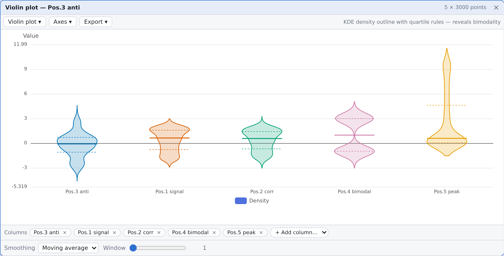
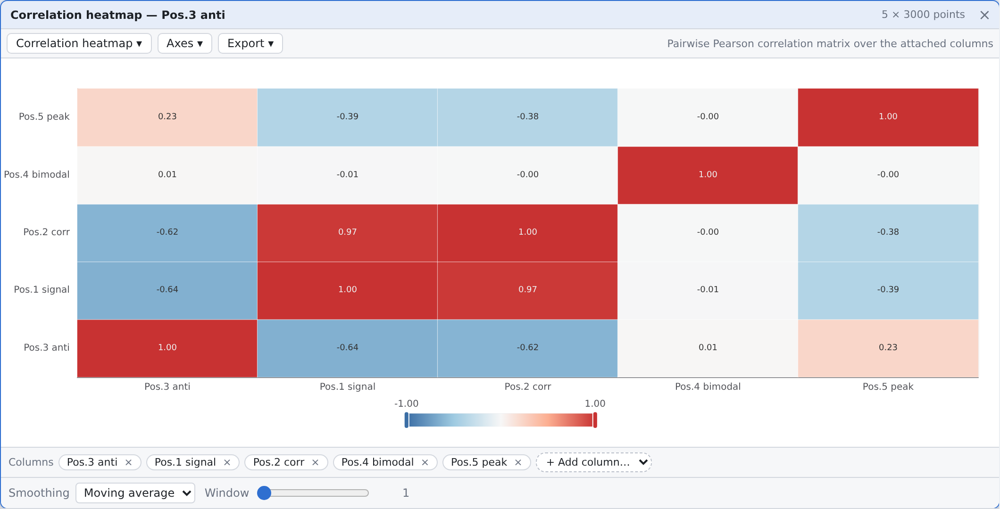
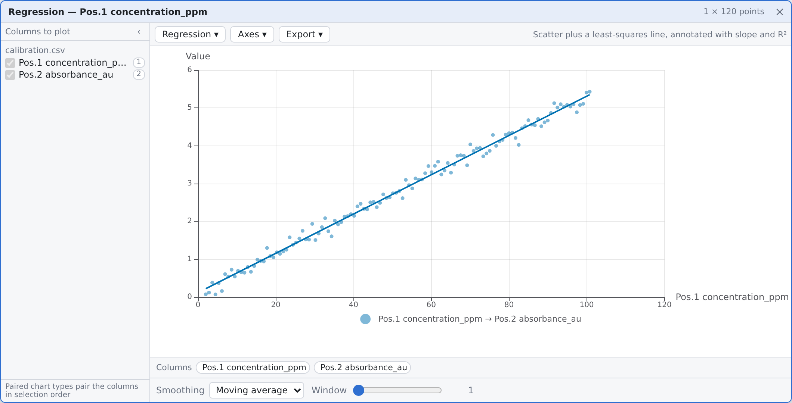

# DataCardForge — Web Frontend

卡片式**数据矩阵批处理工作台**的 Web 前端（React + Vite + TypeScript）。

> 这是项目的**主实现**（自 2026-10-14 起，选型结论见
> [`docs/decisions/2026-10-14-frontend-web-chosen.md`](../docs/decisions/2026-10-14-frontend-web-chosen.md)）。
> 原先作为行为参照的 Qt Widgets 版本已于 2026-10-15 **彻底移除**（见
> [`2026-10-15-qt-implementation-removed.md`](../docs/decisions/2026-10-15-qt-implementation-removed.md)）：
> 本目录下没有并行实现需要同步，语义的唯一权威来源是本目录源码与 `tests/`。

## 快速开始

```bash
cd web
npm install

npm run dev        # 开发服务器（默认 http://localhost:5173）
npm run build      # 类型检查 + 生产构建 → dist/
npm run preview    # 预览生产构建
npm test           # 594 个单元测试（vitest）
npm run typecheck  # 仅类型检查
```

端到端冒烟测试（102 项检查，需要先起 `npm run preview`）：

```bash
node scripts/smoke.mjs http://127.0.0.1:4173
```

## 统计图表

**9 种**科研/统计常用图型，全部用 ECharts 的 **SVG renderer** 渲染，因此**全部可导出为真矢量**。
图型可随时在图表卡片内切换（不用重建卡片）。

| 图型 | 说明 | 实现 |
|------|------|------|
| **折线图** | 按行号绘制一个或多个列，支持对数 Y 轴、次坐标轴 | ECharts `line`（LTTB 降采样） |
| **散点图** | 两列配对为 (X, Y)，可叠加拟合线 | ECharts `scatter` |
| **回归图** | 散点 + 最小二乘拟合直线，标注斜率与 **R²**、样本数 n | `scatter` + `line`（自算 OLS） |
| **柱状图** | 按行号，支持分组 / 堆叠 | ECharts `bar`（large 模式） |
| **直方图** | 单列分箱频数分布，分箱数可自动（Sturges）或指定 | 自算分箱 + `bar` |
| **箱线图** | 每列一个箱体：中位数、四分位数、须线、**Tukey 离群点** | ECharts `boxplot` + `scatter` |
| **小提琴图** | **KDE 密度轮廓** + 四分位线，能看出双峰分布 | `custom` series（ECharts 无原生小提琴） |
| **均值±误差棒** | 每列均值与离散度：**SD / SE / 95% CI**，帽宽可调 | `custom` series（ECharts 无原生误差棒） |
| **相关性热力图** | 多列两两 **Pearson 相关系数**矩阵，发散配色 | ECharts `heatmap` + `visualMap` |



> 小提琴图显示分布形状：**双峰**结构在箱线图里看不到，这是它在本场景下的主要用途。
> 图中还能看到四分位虚线、中位实线，以及 KDE 曲线随样本范围延伸的镜像边缘。





### 统计量

`src/core/stats.ts` 全部为纯函数，独立可测（40 个单元测试），数值约定与 NumPy/R 一致：

- 分位数用**线性插值**（NumPy 默认 / R type 7），Bessel 校正样本方差
- 直方图：Sturges 规则自动分箱；最大值归入最后一个箱；等值数据不退化为除零
- KDE：**Silverman 经验带宽**；常数样本有有限带宽兜底
- 线性回归：OLS + **t 分布** 95% 置信区间（小样本用 t 而非正态，避免低估）
- 相关系数：常数序列返回 `NaN`（相关性**未定义**），而不是谎报 0
- 离群点：Tukey 1.5×IQR

## 导出（矢量优先）

导出是图表卡片工具栏的**一级控件**，不是藏在图表工具箱里的小图标。

| 格式 | 是否矢量 | 说明 |
|------|:--:|------|
| **SVG** | ✅ **真矢量** | 图表本身以 SVG 渲染，导出的是**活 DOM 树**序列化结果：曲线仍是曲线、文字仍是文字、无内嵌位图。期刊投稿用这个。 |
| **PNG** | ❌ 位图 | 可选 1× / 2× / 4× 分辨率（4× 用于印刷） |
| **PDF** | ❌ 位图封装 | 单页 PDF，内嵌高分辨率位图；UI 明确标注非矢量，避免误当矢量图投稿 |

PDF 之所以不是矢量：浏览器里生成真矢量 PDF 需要把 SVG 的路径/文字几何完整翻译成 PDF 绘图算子。
本项目手写了极简 PDF 生成器（`src/charts/pdf.ts`，无第三方依赖）：解析 canvas 出的 PNG、拆 RGB 与
alpha 通道、必要时生成 `/SMask` 保留透明，再包成 `XObject`。

**EPS 不提供**：浏览器端没有可行的 PostScript 生成路径（EPS 是 PostScript 程序，不是几何格式）。
需要 EPS 的投稿流程建议 SVG → `inkscape --export-type=eps` 或 `rsvg-convert -f eps`。

导出实现的两点考量：

1. SVG 导出会**内联计算样式**——ECharts 用 CSS class 设置部分属性，不内联则离开本应用样式表后渲染错。
2. 散点类图型**默认截断到 5 000 点**：ECharts 为每个散点生成一条 SVG path，10 000 点会产出 ~1 MB 的
   SVG。截断是确定性的（等距抽取，保留首尾），既保留点云形状又是可发表的体积。

## 功能

| 功能 | 说明 |
|------|------|
| 卡片工作台 | 卡片可拖拽、缩放、层叠；右键空白 → 打开数据文件；支持把文件直接拖入画布 |
| 多文件卡片 | 一个卡片装多个文件，顶部下拉切换；**切换文件会联动所有依赖它的图表** |
| 多列图表 | 图表左侧可折叠「列」面板勾选要绘制的列，配合「图型」下拉切换；散点/回归按 (X,Y) 配对 |
| 大表虚拟滚动 | 只渲染可见行（实测 10 000 行 → 23 个行节点） |
| 右键列头出图 | 列头右键直接选图型（列数不够的图型会置灰） |
| 平滑 | 滑动平均 / 指数 / 中值 / Savitzky–Golay（移植时与已删除的 C++ `Smoothing.cpp` 逐行对照，现由 18 个测试锁定） |
| 连接线 | 贝塞尔曲线，按**卡片**画线（一条依赖边一条线，与列和表格滚动无关）；源卡片选中=红、目标选中=蓝、都未选中=灰（背景层）；拖拽/缩放实时跟随 |
| 解析离开主线程 | 文件解析在 Web Worker 中进行，无 Worker 环境自动回退内联执行 |
| 内容寻址缓存 | 按 `size`+`lastModified` 复用解析结果；同名不同内容的文件不会被当成同一个 |
| 依赖保护 | 有图表依赖的表格拒绝关闭，连线闪烁提示 |
| 表格导出 | 当前表格导出 CSV |
| 工作区持久化 | 保存/恢复工作区（卡片布局 + 图型配置 + 依赖 + 已解析数据）为 JSON |
| 视图整理 | 平铺 / 层叠 / 关闭全部 |
| 中英切换 | 运行时切换 UI 语言（含图表轴标题与图例） |

## 技术选型

| 关注点 | 选型 |
|--------|------|
| 构建 | Vite 8 |
| 语言 | TypeScript 7（`strict`, `noUnusedLocals`） |
| 视图 | React 19 |
| 卡片窗口 | 自研 `CardShell` + react-rnd |
| 绘图 | ECharts 6（**SVG renderer**） |
| 状态 | zustand |
| 表格 | 自研虚拟滚动（无第三方） |
| 测试 | vitest + Playwright（冒烟） |

图表库保留 ECharts 而非换库：矢量导出是 SVG renderer 的原生能力，图型覆盖上只有小提琴图与误差棒
没有原生类型（用 `custom` series 实现，不牺牲矢量导出）；替代方案（Plotly.js / Observable Plot /
Vega-Lite）在这两类图型上并无更好覆盖，且包体更大、SVG 导出更绕。完整审计见
[`docs/decisions/2026-10-14-chart-library-audit.md`](../docs/decisions/2026-10-14-chart-library-audit.md)。

## 目录结构

`src/` 按层划分，框架依赖只出现在 `ui/` 与 `loaders/`：

- `core/` — 与前端框架无关的数据层（对应 C++ 的 `core/`）
  - `MatrixData.ts` — 列式矩阵：`Pos.N` 列 + annotation + `number[]`
  - `FileLoader.ts` — 加载器抽象 + 首行标题识别 + 文本解码
  - `DependencyGraph.ts` — 卡片依赖图（dependent → dependsOn）+ 环检测 + 边去重
  - `Smoothing.ts` — 4 种平滑算法 + SG 系数求解
  - `stats.ts` — 统计量：分位数 / KDE / 直方图 / OLS / 相关 / 离群点
  - `numeric.ts` — 严格数字解析（`fast_float` 的替代）
- `charts/` — 图表层（与 React 无关，可单测）
  - `chartTypes.ts` — 图型注册表 + 导出格式声明
  - `chartModel.ts` — 图表配置：图型 + 数据列 + 呈现选项
  - `chartOptions.ts` — 每种图型 → ECharts option（含 `custom` series）
  - `export.ts` — SVG / PNG / PDF 导出管线
  - `pdf.ts` — 无依赖的极简 PDF 生成器
  - `palette.ts` — 色盲友好调色板（Okabe–Ito）
- `loaders/` — 具体格式解析
  - `parse.worker.ts` — worker 入口：解析并回传 `ColumnPayload[]`
  - `parseWorker.ts` — 主线程侧客户端 + 无 worker 时的内联回退
  - `parseTypes.ts` — 两侧共享的线格式（独立模块，避免 import 期访问 `self`）
- `ui/`
  - `App.tsx` — 根组件：菜单动作、文件摄取、导入导出
  - `workspaceStore.ts` — 卡片状态 + 依赖图 + 关闭规则
  - `cardMetrics.ts` — 卡片矩形测量（连线端点 = 卡片顶部中心）
  - `ConnectionLayer.tsx` — SVG 卡片级连线层（一条依赖边一条线）
  - `i18n.ts` — 中英词典
  - `fileActions.ts` — 文件选择 / 下载 / 工作区读写
  - `components/` — `CardCanvas` / `CardShell` / `MatrixCard` / `ChartCard` / `ColumnDock` …
- `scripts/smoke.mjs` — headless Chromium 端到端冒烟
- `tests/` — vitest：594 个用例（`*.dom.test.tsx` 走 jsdom）
- `docs/screenshots/` — 文档配图

## 移植来源：C++ → TypeScript 映射

> ⚠️ **下表左侧的 C++ 路径已于 2026-10-15 从仓库删除**，不再指向可打开的文件，只保留作为
> "每个模块当初从哪里移植来"的出处记录。恢复方式见
> [`2026-10-15-qt-implementation-removed.md`](../docs/decisions/2026-10-15-qt-implementation-removed.md)。

| C++（已删除） | TypeScript | 说明 |
|-----|-----------|------|
| `core/MatrixData.*` | `core/MatrixData.ts` | 语义一致；`cell()` 越界返回 `NaN` |
| `core/FileLoader.*` | `core/FileLoader.ts` + `loaders/*` | 由路径改为 `File`；删除 `split_row` 的 `0` 兜底 |
| `core/DependencyGraph.*` | `core/DependencyGraph.ts` | 原语义一致；Web 侧另补了环检测与边去重 |
| `core/algorithm/Smoothing.*` | `core/Smoothing.ts` | 四种算法逐行对照 |
| （无） | `core/stats.ts` | **新增**：为统计图型补齐统计量 |
| `widgets/MainWindow.*` | `ui/App.tsx` + `ui/components/CardCanvas.tsx` | |
| `widgets/CardRegistry.*` | `ui/workspaceStore.ts` | 依赖改为挂在**卡片**上，见下 |
| `widgets/ConnectionOverlay.*` | `ui/ConnectionLayer.tsx` | 颜色/贝塞尔控制点原样保留 |
| `widgets/MatrixCard.*` | `ui/components/MatrixCard.tsx` + `VirtualTable.tsx` | 列头右键改为选图型 |
| `widgets/ChartCard.*` | `ui/components/ChartCard.tsx` + `charts/*` | QCustomPlot → ECharts，单图型 → 9 图型 |

### 当年相对 Qt 版的**有意**差异

这些是移植时主动做出的选择；Qt 版现已删除，本节说明**为什么 Web 版的语义与历史文档中的 C++ 描述不同**。

1. **无法解析的单元格记为 `NaN`（显示 `—`），不再兜底为 `0`。**
   C++ 的 `TxtLoader` 在 `from_chars` 失败时写入 `0.0`，会静默污染测量数据。
2. **依赖挂在「矩阵卡片」而非「矩阵 id」上。**
   Qt 版 `ChartCard::SourceRef` 记录 `matrixId`，而一个卡片装多个文件时每个文件是**不同的矩阵 id**，
   「切换文件 → 图表联动」在 Qt 版实际无法生效。Web 版把依赖记为`图表卡片 → 矩阵卡片`，
   切换文件时把依赖图表重新指向新激活的矩阵；该行为有单元测试覆盖。
3. **常数序列的相关系数返回 `NaN` 而非 0。** 相关性在数学上未定义，报 0 会谎称「不相关」。
4. **小提琴图不报密度值当 Y 轴。** 曲线沿**数值轴**绘制，宽度编码密度（与 Matplotlib/Seaborn 一致）；
   最初误把密度峰值当 Y 轴范围导致图形被拉伸，已修正并有测试锁定。

## 构建产物

单次生产构建的实测体积（数字随依赖版本变化）：

| 产物 | 原始 | gzip | 载入时机 |
|---|---|---|---|
| `dist/index.html` | 0.42 kB | 0.32 kB | 入口 |
| `dist/assets/index-*.css` | 11.9 kB | 2.8 kB | 入口 |
| `dist/assets/index-*.js` | 341 kB | 107 kB | 首屏 |
| `dist/assets/echarts-*.js` | 1 124 kB | 374 kB | 首次打开图表 |
| `dist/assets/xlsx-*.js` | 492 kB | 160 kB | 首次打开 xlsx |

## 已知限制

- 工作区保存的是**已解析数据**而非文件引用，大文件会得到很大的 JSON
- 缺少少数进阶图型：等高线/密度二维图；带/带状误差（confidence band）**未实现**；
  箱线图不支持凹口（notched）与分组布局
- PDF 导出为位图封装，不是矢量 PDF；EPS 不提供（浏览器端无可行路径，见「导出」）
- 表格单元格可编辑（矩阵卡文件行的锁按钮切换）
- 数值计算（表达式、矩阵运算）由 C++ 后端执行，前端不再新增数值计算；后端现状见根
  [`README.zh-CN.md`](../README.zh-CN.md)与 `STATE.md`

## 许可证

与主仓库一致：**GPL-3.0**。
